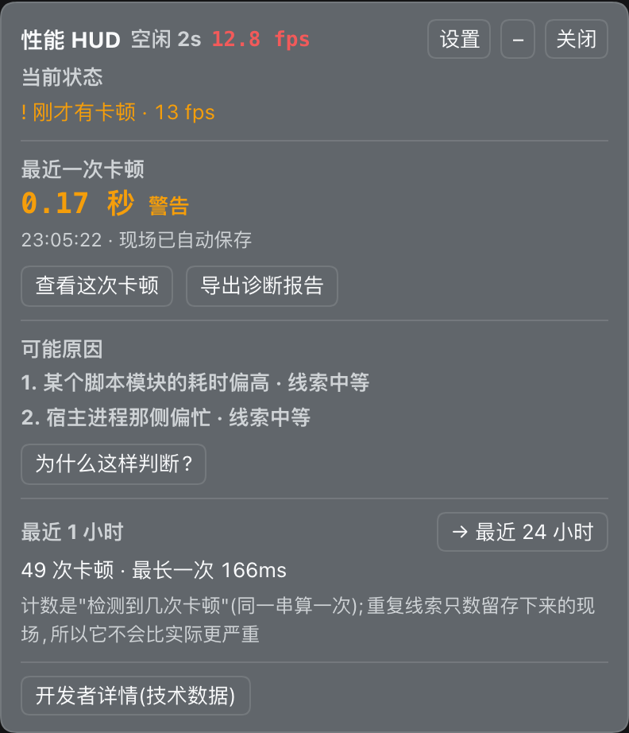
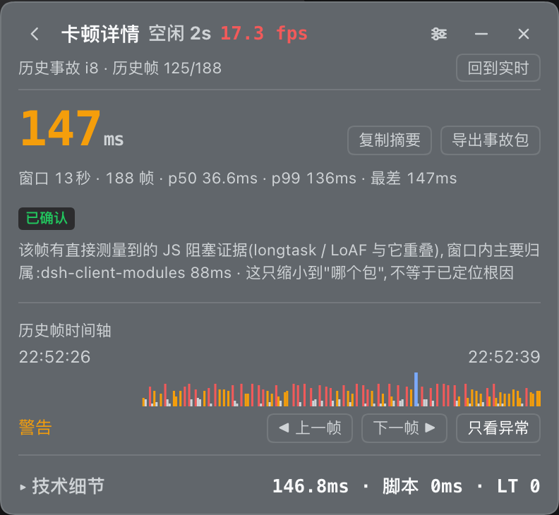
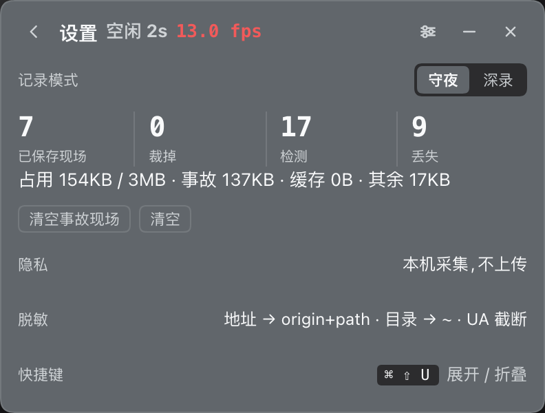
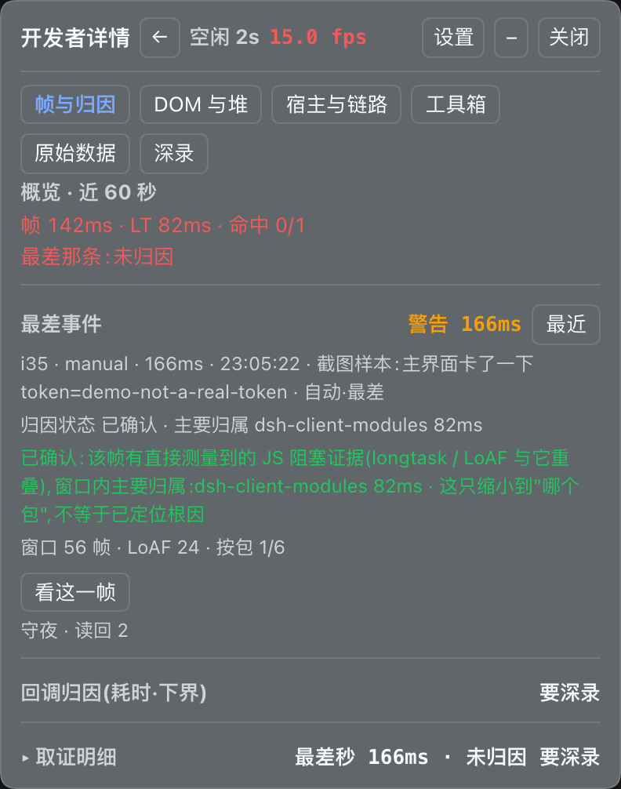
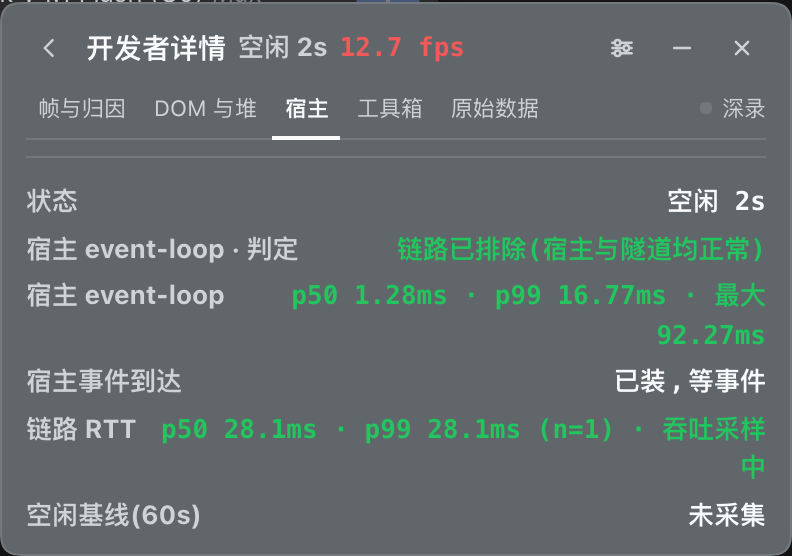
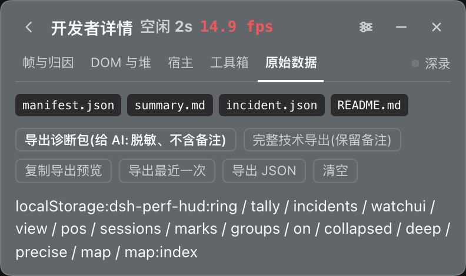

# dsh-perf-hud

> **纯客户端性能 HUD**:右下角一块浮层,回答"现在卡不卡、卡在谁身上"。
> 帧与最差帧 · Longtask(带四条腿归因)· 每插件回调速率与同步耗时 · DOM 增长与写入者 · JS 堆 ·
> 宿主 event-loop 与链路 RTT · 证据包导出 · 守夜(偶发卡顿的事后回看)·
> **守夜层:偶发卡顿自动留存最差几次,连证据一次性导出**。

<p>


</p>

<p align="center">🌏 <b>中文</b> · <a href="./README_EN.md">English</a></p>

> ✅ **v0.6.0 已发布到 npm** —— `dsh plugin --profile web add dsh-perf-hud` 即可(发布门槛与未还的债见
> [REVIEW.md](REVIEW.md))。

## 📑 目录

- [✨ 它回答什么问题](#-它回答什么问题)
- [🧭 和 DSH 自带开发者工具的分工](#-和-dsh-自带开发者工具的分工)
- [🚀 安装](#-安装)
- [📊 面板怎么读](#-面板怎么读)
- [🛰️ 偶发卡顿:守夜层](#️-偶发卡顿守夜层)
- [🔬 四条腿归因](#-四条腿归因)
- [🧪 隔离实验(已移到控制台)](#-隔离实验已移到控制台)
- [⚠️ 风险与边界(必读)](#-风险与边界必读)
- [🧰 控制台 API 与存储键位](#-控制台-api-与存储键位)
- [🛠️ 开发与测试](#️-开发与测试)
- [🤝 参与贡献](#-参与贡献)

## ✨ 它回答什么问题

| 问题 | 面板给的答案 |
|---|---|
| 现在顺不顺? | FPS / 最差帧 / 帧内未归因;标题栏常显「流式 / 空闲 Ns」作为解读前提 |
| 卡的那一下是谁干的? | Longtask 明细 + 四条腿归属(组件名 / 包名 / DOM 写入者) |
| 哪个插件在偷偷跑? | 按插件的回调执行速率(/s)、峰值速率、同步耗时;DOM 写入次数与写入者 |
| 是插件的问题还是宿主/链路的问题? | 宿主 event-loop p50/p99/max + 链路 RTT/吞吐,附阈值判色与「链路已排除」结论 |
| 关掉某个插件到底有没有用? | 隔离实验(控制台):逐个关闭 60 秒,和紧邻基线对照,并给出噪声底 |

## 🧭 和 DSH 自带开发者工具的分工

DSH 自带的实验性**开发者工具**(插件管理器官方分组,`NodeJS 诊断` / `会话数据诊断`)是**前台显微镜**:断点、Host console、网络抓包、原始 session 日志、Cordis 树。本插件是**行车记录仪**:默认常开,记帧、LoAF、事件计时,事后给事故包。

| 想回答 | 用 |
|---|---|
| 现在为什么慢 / 断点 / 网络 / 会话日志 / Cordis 树 | 开发者工具 |
| 刚刚那一下有多慢、是谁、能不能复盘 | 本插件 |

两边不互相依赖。开发者工具的 Performance **只采 Host CPU**,Client 侧只有 Console 求值与只读 Sources,**不给页面渲染 trace / 帧数据**;所以本插件事故包里的 `devtools-trace` 缺失仍然如实保留,不会因为装了它就变成"已补上"。它也**抓全量 Host fetch(含密钥)**,与本插件"导出前减法脱敏"是两套口径。

快捷键:`Cmd/Ctrl+Shift+U` 展开/收起(macOS / Windows;Linux Web 的平台白名单不允许这个组合,未绑定;收起/展开不抢输入框焦点)。

## 🛰️ 偶发卡顿:守夜层

面板要你盯着看;偶发卡顿恰恰发生在你没看的时候。所以插件**默认开着一层不插桩的记录器**:

- 每帧一条**帧级环形缓冲**(12000 条 ≈ 60fps 下 3.3 分钟),另加一个 LoAF 观察器(Chrome 123+);
- 一帧超过 **100ms**(或 LoAF 的 `blockingDuration` 超过 100ms)就**自动抓一次**:前 10 秒 + 后 3 秒**原样切片**,不等你反应;
- 留存取**三档并集**:全局最差 **10** 次 + **每天最差 1 条**(最多最近 7 天,清单里标「当天最差」)+ **最近 3 次**(不看严重度,标「最近一次」)—— 只按全局最差排时,同一小时里的 10 次会把"昨天下午那次卡"整条挤掉(实测 `捕获 40 · 丢弃 38`)。抓到了但没留存下来的次数单独记(`dropped`),与"没抓到"分开;
- 事故包把脚本 URL 抽成一张表(`urls` + `scripts[].u`):同一个 combo URL 会被写几十遍,抽表之后**一份小 4 倍**(实测 116.6KB → 29.6KB),信息一点没丢;
- 落盘另有 **3MB** 字节上限,超了就从最弱的开始裁(最近档最后动);配额真的不够时**先丢掉可重建的 sourcemap 分段表**,再谈裁证据 —— 裁掉的条数写在常显那一行的「裁掉 N」里,内存按同一份裁(看到的永远等于刷新后还在的)。(上限原本是 512KB,但实测一个晚上就被裁了 6 次、实际只留得下 8 条):刷新页面、重启浏览器之后还在,`watch().restored` 告诉你这次读回了几条;写不进去会如实报 `persistError`,不假装存下来了;
- **"发生了几次"和"留了几份现场"是两个数,分开算**(产品计划 §3.A):留存清单受容量限制,**它的条数不能回答"最近卡了几次"** —— 被挤掉的卡顿不是没发生。所以另有一层轻量计数:每分钟一个桶、只留最近 24 小时,再按天汇总 30 天(跨刷新)。三个数各有各的名字,面板悬停里都写着:
  - **检测到 = triggered** —— 起过几次捕获。一次卡顿通常是一串触发,而**这一串只算一次**;被并进同一次 pending(或落进已覆盖窗口)的那些触发**不算新的一次**;
  - **同串触发(coalesced)** —— 上面那一串里被并掉的触发个数。它是"这一串有多密",**不是次数**:把两者相加会把一次停顿记成十几次(在真页面上实测踩过,一次 3 秒的后摇里每帧都触发一次);
  - **已保存现场 = 留存清单的条数** —— 受容量限制(最差 10 次 + 每天 1 条 + 最近 3 次),**不等于**检测到;
  - **丢失 = (triggered − captured) + dropped + trimmed + failed** —— 起过捕获却没能切成现场 / 抓到了但没留存下来 / 字节装不下被裁 / 写盘失败,单列,不混进"检测到"。
  折叠药丸上那一格 `检测 N 次` 说的是**最近 24 小时**(跨刷新),不是留存份数;悬停里三个数各自的名字与口径都写着(`__perfHud.tally()` 同一个口径)。
- 标签页隐藏造成的几百秒"间隙"**不算卡顿**(rAF 被挂起),事故包里标成 `gap`;
- 这一层**不包装任何原型**:只用本来就在跑的 rAF 循环与一个 `PerformanceObserver`,所以默认开着也不改你的环境。

```js
__perfHud.watch()             // 在不在录、覆盖多少秒、LoAF 装没装上、抓到几次
__perfHud.incidents()         // 最差几次的摘要(索引 0 最差)
__perfHud.report(0)           // 完整事故包:帧序列 + LoAF 条目 + 窗口内 longtask + 环境读数
__perfHud.exportIncident(0)   // 下载成 JSON —— 把这份丢给分析的人(或 agent)就行
__perfHud.capture('切了视图')  // 手动标记"刚刚卡了一下"(自动回退 3 秒的反应时间)
__perfHud.clearIncidents()    // 只清事故;clear() 刻意不动它
```

事故包里的脚本**会定到包名**:合并批(58 个包挤在一个 URL 里)靠"字符位置 → 行号 → sourcemap 分段表"还原,单包 URL 直接从 URL 读;拿不到时写清为什么(精确归因没开 / 文本还在拉 / 越界),并按包给一份汇总 —— 这一层才是"是谁"。

导出文件名是 **`perf-hud-20261008-220358-i84.json`** —— 事故发生时刻的本地时间 + 事故 id(不是导出时刻;日期在前可排序,完整 ISO 在文件体里)。

**看的是哪一帧、怎么翻**:圆环上面有一行 `帧 1/12 · 530ms · ≥100ms ◀ ▶ ⟲` —— 判据与排序统一用 `frameSeverity = max(blocking, 帧时长)`:清单只收最近 200 条长动画帧里**值得回看的**(**帧时长 ≥ 100ms**,与守夜触发线同一条;刚过 50ms 的边角帧不进榜),排序也按 `max(blocking, 帧时长)`、最差的排第一(**blocking 只是补充** —— 只看它会把 92ms 的帧排到 300ms 的帧前面);一条都不到线时退回显示全部(那时标签上不出现 `≥100ms`)。默认是**自动**:一直跟着最差那条走(所以没有更差的出现时,它不会变);按 ◀ ▶ 换一条看,就**钉住**那一条,⟲ 回到自动。选中的那条被挤出 200 条之后会自动退回自动,不会指着一个已经不在环里的帧。

**长动画帧的时间去哪了**:「取证明细」里有一张**恒定四段**的圆环(84px),段与段之间留 1.4px 缝:

- **脚本**(被 LoAF 归到脚本的同步 JS)= 红;**任务**里没归到脚本的那部分(短于上报阈值的脚本 + 事件派发 / 微任务 / GC)= 中性灰;**渲染**(rAF 回调)= 橙;**样式+布局+绘制** = 蓝。

环只说这一件事("帧的时间分给了谁")。**脚本内部"是谁"、以及"哪个包"另画两条 100% 堆叠横条**(紧接着的「按来源」「按包」两行:上面是每项一行的小表(名字左、毫秒右),下面一条是占比;段越靠左越重(不透明,名次靠压暗而不是变透明),段间 1px 缝,小段保底 3px;鼠标停上去给 `名字 毫秒 · 占比`;顶段 ≥ 80% 时条右边会内联一个占比,例如 `86%`)。**两个维度交叉**的问题("哪个包的哪类回调")交给再下面那张**可折叠的交叉表**,默认收起,展开是 Top3 × Top3 + 其余行列。**悬停联动整体停用、辅助代码已删干净**(环 ↔ 按来源/按包堆叠条 ↔ 交叉表):2026-10-08 实测「鼠标指到交叉表的行标签会让整个面板被外壳停用」,而且它**不经过我们自带的那层错误边界**(连错误原文都拿不到);2026-10-11 在当前代码上又**复现不出来** —— 既不能证明根因、也不能证明已修好,所以保持停用(见「风险与边界」第 9 条);环、两条堆叠条与交叉表本身照常工作。小表的**每一行可点**(点了复制「名字 + 毫秒」到剪贴板,成功/失败都照实显示),但**堆叠条的色段本身不可点** —— 它只是同一份数据的比例视图,没有别的去处。

**这是页面内能拆到的极限**:绘制与合成在页面内分不开(要分开只能录 Chrome trace),所以最后一段是"剩下的都在这儿"。

**脚本那一侧再拆三层、两个分母**:「本帧」那组第一行(以及窗口组在非全纯执行时的对应行)把脚本耗时拆成 纯执行 / 强制样式布局 / 暂停 —— **三者是分区,相加 = 脚本耗时**,不是另加的时间(`forcedStyleAndLayoutDuration` 是读布局 / 写样式逼出来的同步布局,`pauseDuration` 是同步 XHR、对话框把它卡住的时间)。

再往下是**同一份脚本耗时的两种切法**,由两个小标题分成两组:

- **「本帧」**= 上面那张饼的**同一帧**(数字能和饼对着看);**「窗口」**= 最近 200 条 LoAF 的累计,范围就写在小标题上:`窗口:200 条长动画帧 · 跨 43分12秒 · 平均每帧脚本 108.1ms`。范围写在标题上,行标签就不用每行重复"本帧 / ·窗口"。
- **按来源**(LoAF 的 `invoker`):这条脚本**是谁调起来的** —— `setTimeout`、`DOMWebSocket.onmessage`(会话事件流的消息处理器,实测最常见)、`Response.json.then`(Promise 回调)、`script`(脚本加载)…… 覆盖全部脚本,所以合计 = 脚本耗时。
- **按包**:单包 URL 直接读出来,合并批按 sourcemap 分段还原(与事故包 `incident.packages` 同一条路)。**只覆盖"定得到包名"的脚本**,所以合计 ≤ 脚本耗时;**第一名是应用外壳 bundle 时(如 `index-CN7NIWNw.js`),紧接着会有一行"最大一块来自应用外壳(不是插件)"** —— 那是宿主 / React 根那一层,从来不属于任何插件,它排第一**不等于**某个插件是元凶(脚本毫秒是直接测量的,归属是推断的);名字后面会跟一段 **「其余来源」**,那是定不到插件包名的部分,而且**按原因给名字**:`无 URL(内联脚本)`(内联 / 动态构造的处理器)、`插件批次(未按 sourcemap 拆)`(URL 在 `plugins/` 下但还没拆)、或者**直接就是文件名**(比如 `index-5SrrfWpU.js` —— 那是应用自己的外壳 bundle,React 根容器上的事件处理器就来自它,它本来不属于任何插件)。**先看「其余来源」那段有多少毫秒,再读排行。**
- 这一层只回答"**哪一类调用**",不回答"函数里面慢在哪":函数级要 Chrome trace(JS Self-Profiling 被 `Document-Policy` 挡着,页面内没有采样器,实测 `new Profiler()` 直接抛 `NotAllowedError`)。

**只有"平均每帧脚本"那一栏和饼可比**(饼是单帧;除数其实是**帧数**,不是脚本条数);`纯执行 21623.8ms` 这种是 200 条各百来毫秒攒出来的累计,不是某一次执行花了 21 秒 —— 跨度越久累计越大。值超过一行时按块式换行(左对齐),不挤标签。

**面板会自己藏掉没意义的行**(字太多本身就会让人读不动):「**回调归因**」那一块**总在「开发者详情 · 帧与归因」里**,没开「深录」时降级成一行 —— 标签 `回调归因(耗时·下界)` + 值 `要深录`(Top3 表与「其余 (N)」行都不渲染;**绝不写 `0ms/s`**,那会被读成"没有开销");插桩之后 `0ms/s` 才是**真的**(确实没有回调跑过那次调度点)。`DOM 写入` 同样只在插桩后显示(不插桩时计数恒为 0)。`帧内未归因` 与组摘要里的未归因直接写"要深录"—— 不插桩时那个数会退化成平均帧间隔,给数就是误导;一个包名都没定到时,「按包」那条**既不会空、也不会摆一行"0 条定到名"** —— 喂给堆叠条的就是 `whoRows(tally)`(定到名的部分 + 按原因命名的「其余来源」),所以那种情况看到的是 `插件批次(未按 sourcemap 拆)` / `无 URL(内联脚本)` / 外壳文件名这些**带名字与毫秒**的段;没定到名的原因是合并批要靠 sourcemap 还原,而那条路只在「深录」(精确归因)打开时才拉。

**「取证明细」组的最前面是一条 60 秒帧条**(从右对齐的窄条改成**铺满一行的块**,约 365px 宽、一格约 6px):一格一秒,柱高 = 那一秒里最差那一帧的间隔,颜色与导出件 ASCII 条带用**同一组阈值**(≥100ms 红 / ≥50ms 黄);每格 hover 给墙钟时间 + 那一秒最差帧多少 + **点得动还是点不动** —— 只有那一秒**真的有长动画帧**(LoAF 环里存在)的格子才可点,点了就把翻帧切到那条帧;点不动的格子明确不给手型,并在 title 里说明。整格都是 rAF 挂起的那一秒画成最矮的灰柱 —— 它是间隙,不是卡顿。展开着不动也能看出"这分钟哪几秒抖了"。

**取证明细一次只服务一个上下文** —— **实时监控**(实时帧环里的当前帧)或**历史事故**(选中事故里的一条历史帧),详情区第一行的上下文标题会写明是哪一支(`实时监控 · 当前帧` / `历史事故 i12 · 历史帧 3/305`)。从实时进历史按「看这一帧」,回实时按「回到实时」;切上下文只切数据源,实时采集与另一侧的选中都不动,刷新后也停在同一条事故的同一帧(上下文落盘,事故/帧找不到就退回自动)。

历史事故那一支的「历史帧时间轴」画的是**选中的那条事故**当时那一段窗口,数据**全部来自事故包**(`incident.frames` / `incident.loaf` / `summary` / `longTasks`),所以**刷新生效**,而且**不增加任何采集成本**。横轴**按时间**放、最多 240 列,**每列取该列最差的那一帧**,点击选中的一定是包里**真实存在**的那一帧;整段 rAF 被挂起 / 采样缺失的地方**留白**,一眼看出"这段时间根本没在测",不是没卡(按序号放会把那个间隔压成一根柱子,那就等于说谎);档位与实时帧条用**同一个函数**、同一组 theme token,两处读数不许打架。下面依次是**范围**(窗口跨度 / 帧数 / p50 / p99 / 最差帧 / 缺口数)、**归因状态**(已确认 / 可疑 / 未归因)、选中帧的**序号 / 耗时 / 档位**与翻帧控件(◀ 上一帧 / 下一帧 ▶,加一个「只看异常」过滤器 —— 开着时步长只落在帧间隔 ≥ 守夜触发线的帧上;没有下一条就禁用)、**这一帧的时间去向**(帧内四段分解,相加 = 这一帧时长)、与这一帧重叠的 **Long Task**、以及**可疑脚本**;它们都在默认折叠的「技术细节」里。⚠️ **两条真实限制**:① **不排帧内执行顺序** —— LoAF 只给每条脚本的耗时,不给它在帧内的起止;② 没有**完整函数级时间轴**(函数名常缺失,页面内也没有采样器)。面板这一层呈现的是事故包里**已经存下来的那些字段**;要看原始证据与更细的数据(全部 LoAF / 脚本条目、窗口内 longtask 明细、按耗时排序的脚本),走「导出事故包」+ `tools/inspect-incident.mjs`。它在「取证明细」组里,**组折叠时不计算**;**历史事故跨会话读回后依然能逐帧回放**(数据本来就在包里)。

**「最差事件」块(开发者详情 · 帧与归因)**(守夜留下的最差那条事故,**按严重度排 —— 「最差」不是「最近」**):标题行是 `id · cause · 墙钟时间`,右边给严重度 —— **文字 + token 颜色两样都给**(`≥200ms` 严重 / `≥100ms` 警告,阈值与面板判色同一条线,不只靠颜色)。这一行的值有**三种状态**:未开录 → `未开录`;没有事故 → `还没抓到(≥100ms)`(阈值就写在这一行里,不再另起一行重复);有事故 → `严重` / `警告` + 毫秒。下面依次是 `自动·最差` / `自动·最近` / `已选中`(标题行右边有个「最近 / 最差」切换,一键切"自动跟着谁"并清掉手选)、**JS 证据**有无(那一帧有没有 longtask/LoAF 与它重叠)、**主要归属**(先取按包汇总的第一名,没有就看 `topScripts[0].pkg`,一个都没定到就写「未归因」)、**窗口行**(帧数 / LoAF 条数 / 按包覆盖率 `已定名/总数`,带分母);再底下那行**只说**"读回 / 裁掉 / 落盘失败"这类状态,不重复"还没抓到"。三个按钮都是**真动作**:**看这一帧**(切到**历史事故**上下文:选中它 + 展开「取证明细」+ 选中这条事故里**最差的那一帧** —— 帧、耗时分解与证据全部来自事故包**自己保存的帧记录**,所以跨会话读回的事故一样能逐帧回看;包里一条帧记录都没有时才写一句如实说明)、**导出事故包**(这条事故的完整证据包)、**复制摘要**(自描述的交接文本:结论 + 口径 + 「可疑脚本」的证据行(最多 4 条)+ 「窗口内 ≥100ms 的交互」(标明是**端到端时长、不是帧内拆分**)+ 缺什么 —— 贴给别人能接着查;整份 JSON 走「导出事故包」)。

**开发者详情 · 帧与归因里能看到:** 三块 ——「概览(现在卡不卡 + 最差那条是谁)」「**最差事件**(守夜留下的事故,见上一段)」「回调归因 Top3(谁的锅,没插桩时降级成一行「要深录」)」;原来的「帧内未归因」搬进了**取证明细**组(数字挂在那一组的摘要上:`最差秒 186ms · 未归因 50ms`),因为它是「解释」不是「结论」;DOM 写入则从这一组挪进了「**DOM 与堆**」组 —— 写入者属于 DOM,不属于"这一帧的时间去哪了"。 工具箱那一行 `守夜 抓到 N 次 · 最差 X ms`(附带最近那一条的时刻与备注);工具箱里有最差几次的清单(**按严重度排、可点选**:选中的那条前面有 `●` 且加粗,点了之后开发者详情里的「最差事件」块跟着走,「取证明细」同时切到**历史事故**上下文(选中那条事故里最差的那一帧)—— 这几处共享同一个选中上下文,存的是**事故 id** 不是下标)+ 「标记刚才」(手动补记,自动回退 3 秒);**导出与清空只在「原始数据」那一页** —— 同一组按钮在相邻两个标签页各印一份,读的人还得先弄清两页有什么区别。清单下面**按需出现**两个布局按钮:**全部折叠**(只在有组开着时出现;收起所有组,不动翻帧与事故选中)与**恢复默认布局**(只在布局/上下文与默认不同时出现 —— 有组开着、翻帧被钉住、手选了某条事故、自动口径不是"最差"、或挂着「已复制 / 定位不到」这类一次性说明;组全收起 + 翻帧回自动 + 事故选中回自动),两者都无意义时整行不渲染;面板折叠成小药丸时显示的是**最近 24 小时检测到几次**(跨刷新保存;**不是**留存份数 —— 留存受容量限制,拿它当发生次数会系统性少报)—— 这个数字就是"行车记录仪在工作"的那盏灯。

事故包带**会话基线**(排除本窗口之后的 p50/p90/最差,所以「比会话最差还差」这种比较才成立),导出件另外带一份**跨会话基线**(每个会话一条 p50/p90/p99/最差/帧数/时刻,最多留最近 20 条)—— 它只进导出件、面板不显示,而且标明是**粗参照,不是回归判定**(会话之间的负载、视口、是否插桩都不同,帧数量级能差一个数量级)。还会写明**最差那一帧有没有 JS 证据**:若既没有 longtask/LoAF 与它重叠、前后又都是 60fps 的健康帧,就标成 `suspectedThrottle` —— 那种情况更像浏览器把 rAF 节流/挂起了一次(窗口被遮挡、省电),而不是页面真的忙了那么久(真实数据里出现过一帧 983.7ms,就长这样),所以能直接回答「这一段是真的比平时差,还是这台机器一直这样」;它是纯 JSON,人也能直接读;想看得舒服点:`node tools/inspect-incident.mjs <file.json>` 会渲染出帧条带(哪一格是哪个量级一眼可见)、窗口内的 longtask、LoAF 与按耗时排序的脚本。它自带 `context.missing`:这一次**没拿到什么**(没有 DevTools trace、没有宿主 CPU profile、平台不支持 LoAF……)以及怎么补 —— 缺的东西写清楚,比不写有用。它**不做归因推断**,只把当时的东西原样装好。

## 🚀 安装

从 npm 安装:

```sh
dsh plugin --profile web add dsh-perf-hud
```

npm 装到的是 `latest`。dsh-plugin.market 的详情页会额外给一条 `github:…/dsh-perf-hud#<40 位 sha>` 的安装命令 —— 那是**把扫描时那个 commit 钉死**的复现命令(保证装到的代码与扫描证据一致),不是日常安装路径。要从 GitHub 固定版本又不想贴 sha,用 tag:

```sh
dsh plugin --profile web add github:yanzhaohui1999/dsh-perf-hud#v0.6.0
```

从源码/本地目录(开发用,`link:` 安装,改客户端半刷新页面即可生效):

```sh
git clone <repo> && cd dsh-perf-hud
dsh plugin --profile web add "$PWD"
```

装完刷新页面即可看到右下角浮层。改动生效方式:

| 改了什么 | 怎么生效 |
|---|---|
| `client.js` 与其分片 `client.*.js`(客户端半) | 刷新页面(dev 环境下客户端 HMR 也会自动热载;只改分片时先 `touch client.js`,rev 才更新) |
| `index.js`(宿主半) | 必须重启宿主服务 |
| `package.json` 的 `dsh.*` | 重装或重启 |

> 宿主半是**可选**的:它没加载时面板照常工作,只是「宿主 event-loop」「宿主事件到达」两处显示不可用,并写明原因 —— 不假装成功。

## 🧭 界面结构(方案 1:整屏切换)

面板有**四个视图**,一次只显示一个(落盘只存"在看哪个视图",不存读数):

| 视图 | 给谁 | 回答什么 |
|---|---|---|
| **主界面**(默认) | 普通用户 | 现在顺不顺 + 最近 60 秒的帧间隔分布 / 最近一次卡了多久、什么时候 / 可能是什么原因(每条都带**支持与限制**)/ 最近 1 小时或 24 小时发生几次、有没有重复线索;两个主操作是「查看这次卡顿」与「导出诊断报告」 |
| **卡顿详情** | 想看那一次 | 独立一屏,顶部有一个返回键(「←」,悬停给"回到主界面");**默认只给结论层** —— 窗口范围、归因状态、真实时间轴与翻帧(◀ ▶ + 「只看异常」),加上对这条事故的两个动作(复制摘要 / 导出事故包);**技术读数收在默认折叠的「技术细节」里**(帧内分解 / 脚本细拆 / 重叠 long task / 可疑脚本 / 包 × 来源 / 口径),展开才看 —— 数据全部来自**它自己**的事故包 |
| **开发者详情** | 开发者 | 5 个标签页:**帧与归因** / **DOM 与堆** / **宿主与链路** / **工具箱** / **原始数据** —— 现有能力一个都没删,只是从"一屏铺开 + 折叠组"变成"选一个标签页看一组"(「深录」开关只在这一屏的标题栏与设置页出现) |
| **设置** | 所有人 | 记录模式(守夜默认常开 / 深录要显式开)、数据保留策略(含**插件占用 / 上限**:事故 / sourcemap 缓存 / 其余三块)、隐私与脱敏口径 |

默认那一屏**不出现** LoAF / p99 / RTT / 包名排行 / 帧编号 —— 那些在开发者详情里。折叠起来时是右下角那颗药丸(fps / 最差帧 / 最近 24 小时检测到几次),点开回到主界面。

### 四屏一眼看完

| **主界面**(默认) | **卡顿详情** | **设置** |
|---|---|---|
|  |  |  |

**开发者详情**的五个标签页(现有能力一个都没删,只是分到五个页签里):

| **帧与归因** | **DOM 与堆** | **宿主与链路** |
|---|---|---|
|  |  |  |

| **工具箱** | **原始数据** | 折叠起来就是右下角那颗**药丸** |
|---|---|---|
|  |  |  |

### 怎么走到每一屏

1. **展开**:点右下角药丸的 `+` → 回到**主界面**(药丸上那三个数是 fps / 最差帧 / 最近 24 小时检测到几次);
2. **看那一次卡顿**:主界面「查看这次卡顿」→ **卡顿详情**(顶部「←」回主界面);这一屏默认只有结论与时间轴,想看这一帧的时间去向就展开「▸ 技术细节」;
3. **看技术数据**:主界面底部「开发者详情(技术数据)」→ 五个标签页(「深录」开关在这一屏的标题栏与设置页);标题栏右上「设置」→ 设置页;
4. **交给 AI**:主界面「导出诊断报告」→ 先出**预览卡**(四份文件 + 压缩包大小 + 「备注:已置空」)→「生成并导出」下载**一个 zip**;
5. **本机排查**:开发者详情 · 原始数据里有「完整技术导出(保留备注)」——那条路**保留**你手敲的备注,不是脱敏件,别直接交出去。

> 截图由 `node tools/shots.mjs` 生成:每张图都**先把视图状态写死再刷新**,所以图与代码里的那一屏一一对应,
> 改完界面重跑一遍就全量更新(它需要本机跑着 `dsh web`,不在 `npm test` / CI 里)。
> ⚠️ 截图放在 `docs/images/`,**不在** `package.json` 的 `files` 白名单里 —— 它们是给 GitHub 上的 README 看的,
> 不跟着 npm 包走(README 本身会随包发布,所以 npm 页面上这些图会是空的;真要以 npm 为主再把它加进白名单)。

## 📊 面板怎么读

> ⚠️ **本节的行级口径描述的是「开发者详情」里的那些块**(界面结构见上一节)。默认那一屏是**主界面**:只有当前状态 / 近 60 秒帧分布 / 最近一次卡顿 / 可能原因 / 最近趋势五块 + 两个主操作,行级细节(包名、帧编号、LoAF / p99 / RTT)都不在那儿。截图与逐步操作在真机验收之后补。

面板分**三档**,默认是最便宜的那一档 —— 它测的是别人的性能,所以自己必须先便宜、可关、可还原:

| 档位 | 什么时候 | 做什么 | 代价 |
|---|---|---|---|
| **守夜**(默认) | 一直开着 | 帧级环形缓冲 + LoAF 观察器 + 交互计时;自动留存最差 10 次 + 每天最差 1 条 + 最近 3 次 | **零插桩**:只挂本来就在跑的 rAF 和两个 `PerformanceObserver`,不动任何全局 |
| **现场** | 想看一眼,展开面板 | 概览 / 最差事件 / 回调归因 Top3 / 守夜那行;其余五组折叠 | 与守夜**同一档采集** —— "展开看看"不会改变被测对象 |
| **深录** | 开发者详情的标签页行 / 设置页 | 才装上 `setTimeout` / `setInterval` / `rAF` 与 DOM 写入的包装,并顺带拉那份 12MB 的合并批 sourcemap(精确归因) | 有代价,**必须显式开**;关掉立刻还原成原生引用 |

**开发者详情**里分五个标签页(帧与归因 / DOM 与堆 / 宿主与链路 / 工具箱 / 原始数据 —— 见上一节「界面结构」),每个标签页里的组(取证明细 / **技术细节** / 包 × 来源 / DOM 与堆 / 宿主与链路 / 工具箱 —— 「包 × 来源」嵌在「取证明细」里,「技术细节」是卡顿详情那一屏的技术读数入口,两边共用同一份渲染)默认折叠,折叠组的标题栏自带一句话摘要。折叠组**真的是惰性的**:`group()` 支持传一个函数当子节点,收起时**连函数体都不进**,「取证明细」/「技术细节」里那些派生统计(脚本按包 / 交叉表 / 帧条)在收起状态下不再每个 tick 重算。

| 读数 | 口径(面板 hover 里也有同一份) |
|---|---|
| **FPS / 最差帧** | 自己的 rAF 循环,1 秒滚动窗口。合并判色:FPS ≤50 或最差帧 ≥120ms → 黄;≤30 或 ≥200ms → 红(任一触发即降色) |
| **近 60 秒帧分布** | 主界面独立一块(五档一张表):帧环里最近 60 秒的帧按**帧间隔**分档 —— ≤16.7 / 16.7–33.3 / 33.3–50 / 50–100 / ≥100ms(满帧 / 30–60 / 20–30 / 10–20fps / ≤10fps),每档给**条数与占比**。标题行带总帧数(60 秒 60fps 约 3,600 帧,实际以帧环里真发生的为准);占比**两位小数**(3,600 帧里 1 条 = 0.03%,整数百分比会把它抹成 0%),整数不带 `.00`;分母是这段里真的发生了多少帧,rAF 间隙不算帧、不进分母。补的正是守夜线看不到的那一段 —— 持续 20fps(每帧 50ms)一条事故都不会触发 |
| **Longtask** | `PerformanceObserver({entryTypes:['longtask']})`,近 60 秒;命中数 = 四条腿任一给出名字的条数 / 总条数 |
| **帧内未归因** | 帧间隔里没被插桩回调解释掉的部分(样式重算、绘制、等待 vsync)。**CSS 动画只在这里现形** —— 它不经 JS 调度器 |
| **帧 N/M ◀ ▶ ⟲** | 面板在看哪一条长动画帧:最近 200 条里 **帧时长 ≥ 100ms**(判据与排序统一用 `frameSeverity = max(blocking, 帧时长)`,与守夜触发线同一条;不到线的边角帧不进榜,一条都不到线时退回全部)的那些,排序也按 `max(blocking, 帧时长)`、最差在前 —— **blocking 只是补充**,只看它会把 92ms 的帧排到 300ms 的帧前面。默认自动跟着最差那条(没有更差的就不换);选过之后钉住,⟲ 回到自动;选中的被挤出 200 条会自动退回 |
| **最差事件**(开发者详情 · 帧与归因) | 守夜留下的最差那条事故,**按严重度排,不是按时间**(「最差」不是「最近」)。标题行 `id · cause · 墙钟时间`;值有**三种状态**:未开录 → `未开录`、没有事故 → `还没抓到(≥100ms)`(阈值写在这一行里)、有事故 → **严重度文字 + token 颜色两样都给**(`≥200ms` 严重 / `≥100ms` 警告,与面板判色同一条线)+ 毫秒 + `自动·最差` / `自动·最近` / `已选中`(标题行右边有「最近 / 最差」切换,一键切"自动跟着谁"并清掉手选);再来是 **JS 证据**有无、**主要归属**(先取按包汇总的第一名,没有就看 `topScripts[0].pkg`,一个都没定到写「未归因」)、**窗口行**(帧数 / LoAF 条数 / 按包覆盖率 `已定名/总数`,带分母)。它底下那行**只说**"读回 / 裁掉 / 落盘失败",不重复"还没抓到"。这一块里的按钮只做**上下文切换**:实时那一侧给**看这一帧**(切到**历史事故**上下文:选中它 + 展开「取证明细」+ 选中这条事故里**最差的那一帧** —— 帧、耗时分解与证据全部来自事故包自己保存的帧记录,所以跨会话读回的事故一样能逐帧回看;包里一条帧记录都没有时写一句如实说明),已经在历史事故上下文里时,同一个位置给**回到实时**。「导出事故包 / 复制摘要」**不在这里** —— 它们是"对这条事故做什么",属于卡顿详情那一屏自己的动作条(同一屏印两份,读的人得先猜哪一份是真的) |
| **事故清单**(开发者详情 · 工具箱) | 清单**按严重度排、可点选**:选中的那条前面有 `●` 且加粗,点了之后开发者详情里的「最差事件」块跟着走,「取证明细」切到**历史事故**上下文(选中那条事故里最差的那一帧;同一个选中上下文,存的是**事故 id** 不是下标;选中的被挤出留存清单会自动退回自动)。清单下面两个布局按钮都**按需出现**:**全部折叠**(只在有组开着时出现;收起所有组,不动翻帧与事故选中)、**恢复默认布局**(只在布局/上下文与默认不同时出现 —— 有组开着 / 翻帧被钉住 / 手选了事故 / 自动口径不是"最差" / 挂着一次性说明;组全收起 + 翻帧回自动 + 事故选中回自动,并清掉「已复制 / 复制失败」与「定位不到帧」这两句一次性说明),都无意义时整行不渲染 |
| **帧里花在哪**(恒定四段的环) | 最近那条长动画帧按 LoAF 的三个时间点拆成四段:**脚本**(红)/ 任务里没归到脚本的那部分(中性灰)/ 渲染(rAF 回调,橙)/ 样式+布局+绘制(蓝)。段间 1.4px 缝,小到扣不起缝的段不扣。**绘制与合成分不开** —— 要分开只能录 Chrome trace,所以最后一段是"剩下的都在这儿",**不能读成"样式布局占比"** |
| **按来源 / 按包**(两条 100% 堆叠条) | 同一份脚本耗时的两种切法,各一条满宽的条:上面是"名字 + 毫秒",下面是占比(Top3 + 其余,段宽 = 该维度内的占比)。来源覆盖全部脚本(合计 = 脚本耗时);按包只覆盖定得到包名的那些,其余按原因给名字(`无 URL(内联脚本)` / `插件批次(未按 sourcemap 拆)` / 外壳文件名);**第一名是外壳文件名时会另起一行说明"不是插件"**。**两个合计本来就不相等**,别互相印证。小表的**每一行可点** —— 点了复制「名字 + 毫秒」到剪贴板,成功/失败都照实显示(`已复制` / `复制失败: 原文`);**堆叠条的色段本身不可点**(以前是手型却没有任何行为,那是假按钮,已去掉)。**悬停联动仍然停用、辅助代码已删**(见「风险与边界」第 9 条) |
| **包 × 来源 · 窗口**(默认折叠的交叉表) | 两个维度交叉开:行 = 包(或"其余来源"),列 = 调用来源,格子 = 毫秒(悬停给占比)。只展开 Top3 × Top3,其余行列用减法补足,四块之和 = 脚本总耗时。组标题写明范围是**窗口**,hint 也写明那是最近 200 条长动画帧的**累计**(与上面那两行「·窗口」是同一份数据),**不是某一帧**。回答的是"**哪个包的哪类回调**在烧时间" |
| **可疑脚本**(在「取证明细」里) | 把「**事故 → 帧 → 来源 → 包 → 文件:行**」落到**个体脚本**上:上面那几块回答"时间花在哪个包 / 哪类调用"(排行),这一块回答"**打开哪个文件、哪个函数**"(定位)。最多列 **4** 行,按耗时降序,而且**只列能定位的行**(函数名 / 包名 / 文件至少有一个 —— ⚠️ **光有行号不算**:合并批里的行号不知道属于哪个包,指不出任何可打开的东西;一个定位字段都没有的行不占名额,不再摆"函数名未记录 @ 包未定名 + 毫秒");每行 `<函数名> @ <包名>` + 毫秒;**只有函数名、定不到包也定不到文件的行会带一个「未定位」后缀**(压缩后的脚本经常两个都没有 —— 毫秒仍是真的,所以不滤掉这一行,但它指不到任何文件,别当线索),悬停给完整证据行,**点这一行复制**「函数 @ 包 · 文件(:行) · 耗时 · 来源」到剪贴板(成功/失败都照实显示)。⚠️ **合并批不拼 `文件:行`**:那种脚本的行号属于**合并后的大文件**,而文件只回答"这段代码属于哪个包的那个文件" —— 两者不是一个坐标系,拼起来看着精确其实指不到任何一行,所以显示成 `文件 · 合并脚本行 25580`(行号单独一段、写明它只在合并脚本里成立)。范围写在标题上:**事故优先**(`可疑脚本 · 事故 i84 · 窗口内`,事故的脚本是窗口内切片、最多 5 条、**跨会话读回之后仍在** —— 这几行的包 / 文件 / 行号读的是**捕获那一刻存进事故包的定位**(`summary.topScripts[]`),不是现算,所以刷新、关掉深录都不会把它算成 `null`);没有事故的脚本时才退回 `可疑脚本 · 本帧`。底下一行**只给分母 + 一句悬停提示**(`11条脚本 · 定到包 1/11 · 悬停看口径与缺口` —— 分母按**全部**脚本算,不随上面列出的行数变,所以"没定到名"这件事不会被藏起来);**口径与缺口全文进悬停**(`evidenceFooterTitle`,与「复制摘要」共用同一份措辞)—— 面板是纯文本渲染、不是 markdown,`**` 与反引号摊在正文里只是噪声。一条能定位的都没有时整块收敛成**一行带分母的说明** `可疑脚本:0 条定到名(窗口内 11条脚本)· 要深录`,同样悬停给口径与缺口 |
| **可疑脚本的三档口径** | ① **直接测量**:函数名与毫秒来自 LoAF 自己(`sourceFunctionName` / `duration`);② **归因推断**:包名 / 文件路径 / 行号是由 URL 与 sourcemap 分段表**推出来的**(悬停看这一行属于哪一档:直接读出来 / 分段推断 / 不是插件脚本 / 解析失败 / 还没到位);③ **尚无法确认**:原始源码(TS/TSX)行号、调用栈、函数级耗时 —— 都拿不到。⚠️ **行号是"脚本文本自己的行号"**(单包 URL = 那个文件;合并批 = 合并后的大文件),**不是原始源码行** —— 要原始源码行得解 section 内层 mappings(VLQ),本项目没做。所以这一层能缩小到"哪个包的哪个文件哪一段",**不能直接指出根因**。**深录才拿得到文件与行号**:默认(不插桩)时合并批的包名定不出来(精确归因关着),那一块通常就是"要深录";**函数名经常是"未记录"** —— 合并/压缩后的脚本里 LoAF 常常不给 `sourceFunctionName`,面板照实写,不编。**事故那一侧读的是"捕获时存下来的定位"**:面板展示与「复制摘要」的证据行由**同一个函数**生成(同一份口径),所以不会出现"面板上有、复制出来没有";只有老事故包(加 `file` / `line` / `lineVia` / `invoker` 之前抓的)缺字段时才回退现算 —— 现算依赖当前会话的精确归因与内存里的脚本文本 / 分段缓存,刷新后两者都是空的,所以新包必须读存下来的那份,否则历史事故的定位会丢 |
| **本帧 / 窗口**(两个小标题) | 「本帧」那一组 = 上面那张饼的**同一帧**;「窗口」那一行标题自带分母(条数 / 跨度 / 平均**每帧**脚本),它下面三行是最近 200 条 LoAF 的**累计**。同一个口径、**两个分母**,不能互相印证 |
| **脚本细拆** | 脚本耗时拆成 纯执行 / 强制样式布局 / 暂停;**三者相加 = 脚本耗时**(分区,不是另加);为 0 的两项不显示 |
| **按包**(本帧 / 窗口各一行) | 脚本耗时**按包**汇总(与事故包的 `incident.packages` 同一条还原路:单包 URL 直接读,合并批按 sourcemap 分段还原)。「本帧」= 上面那张饼的同一帧,「窗口」= 最近 200 条 LoAF 的聚合。没开深录(精确归因)时,合并批只能给到那个 58 包的批 URL —— 这是刻意的,不硬猜。只覆盖定得到包名的脚本,合计 ≤ 脚本耗时。本帧与窗口用的是**两条不同的 hint**(本帧那条只说这一帧,不再误写"窗口") |
| **窗口那一行标题** | `窗口:N 条长动画帧 · 跨 T · 平均每帧脚本 Xms`。窗口那三行是**累计**(200 条长帧的脚本耗时加总),不是任何一帧的时长;跨度越久累计越大,别读成"越来越慢"。**只有平均每帧那一栏和上面的饼可比**(除数是**帧数**,不是脚本条数) |
| **按来源**(本帧 / 窗口各一行) | 脚本耗时按 **LoAF 的 `invoker`** 汇总:这条脚本是谁调起来的(`setTimeout` / rAF、事件处理器如 `DOMWebSocket.onmessage`、Promise 回调、脚本加载)。覆盖全部脚本,所以合计 = 脚本耗时,与「按包」的合计**不相等是正常的**。`SCRIPT[…]` 收敛成 `script`,带冒号的取最后一段(`TimerHandler:setTimeout` → `setTimeout`),缺失时退到 `invokerType`。**它不回答"函数里面慢在哪"** —— 那要 Chrome trace,页面内没有采样器 |
| **60 秒帧条**(在「取证明细」**最前面**) | 铺满一行的块(约 365px 宽,一格约 6px),一格一秒,柱高 = 那一秒里**最差那一帧**的间隔;颜色与导出件 ASCII 帧条带**逐条对应**(≥100ms 红 / ≥50ms 黄 / 其余正常)。每格 hover 给墙钟时间 + 那一秒最差帧多少 + **点得动还是点不动**:只有那一秒**真的有长动画帧**(LoAF 环里存在)的格子才可点,点了把翻帧切到那条帧;点不动的格子明确不给手型,title 里也说明。整格都是 rAF 挂起的那一秒画成最矮的灰柱 —— 那是间隙,不是卡顿 |
| **历史事故 / 实时两个上下文**(「取证明细」的**唯一**分流点) | 面板一次只服务一个上下文,**实时监控**(实时帧环里的当前帧)或**历史事故**(选中事故里的一条历史帧)。从实时进历史:事故卡片上按「看这一帧」,或在工具箱清单里点一条事故;回实时:按「回到实时」。切上下文**只切数据源**:实时采集与历史那一侧的选中都不动,切回来还是原来那一条。看的是哪一支由详情区第一行的上下文标题写明(`实时监控 · 当前帧` / `历史事故 i12 · 历史帧 3/305`),折叠组标题也会带上事故 id。**刷新之后仍然停在同一条事故的同一帧**(上下文落盘;事故或帧找不到就退回自动)。 |
| **事故回放 · 历史帧时间轴**(历史事故上下文里) | 把**选中的那条事故**当时那一段窗口画成一条可点的历史帧条,标签写明是哪一条、跨度多大(例:`历史事故 i1 · 历史帧 41/46` + 起止墙钟)。数据**全部来自事故包**(`incident.frames` / `incident.loaf` / `summary` / `longTasks`),所以**刷新生效**、**零新增采集成本**;它与那条**实时**的 60 秒帧条是刻意分开的两件事。横轴**按时间**放、最多 240 列,**每列取该列最差的那一帧**(尖刺不会被平均掉),点击选中的一定是包里**真实存在**的那一帧(**不混用实时与历史数据**:这一支的任何一个数都不来自实时帧环,分流只在 `detailContext()` 一处);整段 rAF 被挂起 / 采样缺失的地方**留白**(那是"没在测",不是没卡,不补桩),档位与实时帧条用**同一个函数** `sparkLevel`、同一组 theme token,两处读数不许打架。选中帧是一条蓝色竖线,下面给它的**档位文字**与翻帧控件(**◀ 上一帧 / 下一帧 ▶** 按时间序;再点一下**「只看异常」**把步长限制在帧间隔 ≥ 守夜触发线的那些帧上 —— 它是导航过滤器,不是第二对箭头;没有下一条就**禁用**)。⚠️ **两条真实限制**:不排**帧内执行顺序**(LoAF 不给每条脚本在帧内的起止),也没有**完整函数级时间轴**;面板这一层呈现的是事故包里已经存下来的字段,更细的原始数据仍走「导出事故包」+ `tools/inspect-incident.mjs`。它在「取证明细」组里,**组折叠时不计算**;**历史事故跨会话读回后依然能逐帧回放**(数据本来就在包里) |
| **这一帧的时间去向与证据**(两个上下文共用组件) | 环只画四段(脚本 / 任务里没归到的 / 渲染 / 样式+布局+绘制,相加 = 这一帧),下面两组是**本帧 / 窗口**两个分母的按来源与按包堆叠条,再下面是**与这一帧重叠的 Long Task**(owner / component / 来源)与**可疑脚本**(函数名 @ 包 · 文件:行 · 耗时,点击复制)。历史上下文里这些都只吃**选中那一帧**自己的记录:这一帧没有 LoAF 就写「这一帧没有长动画帧记录」,脚本退回**事故窗口内**的切片时会写明"不是这一帧的",**绝不拿实时帧或别的帧顶上**。包名 / 文件 / 行号用的是**捕获时存下来的定位**,所以刷新之后不会变成"未定名"。 |
| **记录器自身** | 每帧给这个 HUD 自己的 rAF 回调计时,给最近 600 帧的 `p99` / 峰 / 样本数。**测量工具必须自证没有明显改变被测对象** —— 它是"这一层记录器贵不贵",不是页面的开销 |
| **回调归因(耗时·下界)** | 这一块**总在首屏**:没开「深录」时只有一行 —— 标签 `回调归因(耗时·下界)`、值 `要深录`(Top3 与「其余 (N)」都不渲染,**也不写 `0ms/s`**);插桩之后给 `x/s · 峰 y/s`(EMA α=0.4 平滑的执行速率 / 单秒最大执行次数),此时 `0ms/s` 才是真的(确实没有回调跑过),hover 给该秒同步耗时 `ms/s` 与累计 `N× / Xms`。**覆盖范围是下界**:只含 `setTimeout` / `setInterval` / `rAF` 三次调度的回调,事件处理器 / Promise / 微任务 / React 自身调度不计入 |
| **DOM 写入**(在「DOM 与堆」组) | 精确总次数 + 每个写入者的 `≈` 估算(每 10 次采样一次栈,命中按 10 折算);**没开深录不显示**(计数恒为 0,会被读成"没有开销")。**本 HUD 自身的写入不记账**。它从「取证明细」挪到了「DOM 与堆」:写入者属于 DOM,不属于"这一帧的时间去哪了" |
| **宿主 event-loop** | `perf_hooks.monitorEventLoopDelay({resolution: 1})`,每秒 **p50 / p99 / max 三个数都给** —— 只给 p99 会把偶发的秒级停顿藏掉(max 才是"最坏卡了多久");宿主半每秒采一次、ring 保留 300 秒。老版本宿主半没有 `max` 字段时,如实只给 p50/p99 |
| **宿主事件到达** | 宿主用公开 `ctx.on('session/event')` 记「事件提交(`event.time`)→ 监听器被调用」的延迟,不是监听器的 CPU 耗时 |
| **链路 RTT** | 每 10 秒一次 1KB 同源探测(带 cache-buster),吞吐每 60 秒一次 64KB。`p99 > 300ms` 且 FPS 正常且 `n ≥ 2` 才判「疑似链路」 |

**「其余 (N)」** = 除 Top3 外还有几个归属方(名字各不相同,按累计耗时排序),行值给它们的合计速率。

**导出 JSON** 带 `context` 自描述头:场景 / 空闲秒数 / 精确归因与每个 sourcemap 分段的状态 / 宿主路由与 profile、Node、插件版本 / 实验候选与方法 / 全部判色阈值 / 跨会话基线。`window.__perfHud.snapshot()` 与面板「导出 JSON」同源。

**交互延迟**(`event` / `element` timing,只记 ≥100ms 的事件)也只进导出件。那一段给端到端时长 `ms`、推导出来的 `waitMs`(输入延迟)与 `handlerMs`(处理器本身),`isInteraction` 标出哪些是真交互(`interactionId > 0`);**帧内拆分(输入延迟 / 处理 / 呈现)页面内拿不到**,要拆得去 DevTools 的 Interactions 轨道看。`element` timing 只观察带 `elementtiming` 属性的元素 —— DSH 的 DOM 上没有这个属性,所以这一路**恒为 0**,导出件里照实写 0 并解释原因,不假装采到。

## 🔬 四条腿归因

长任务归属同时给出**不一致的两条**,不挑好看的报:

| 腿 | 机制 | 擅长 / 局限 |
|---|---|---|
| `fiber` | 从被改动节点**往祖先**走最近的具名函数组件 | 擅长增量更新;整棵子树一次性挂载时只能给到容器 |
| `子树` | 从被改动节点**往子树**走,优先 `alternate === null`(React 标记"本次新挂载") | 补"整棵挂载"的空档;有界 BFS |
| `DOM写入` | 采样 `appendChild` / `insertBefore` / `setAttribute`(1/10),在写入点抓栈并取组件名 | 提交阶段栈里没有插件帧时的主力;估算值带 `≈` |
| `包名` | 调度点插桩(setTimeout/setInterval/rAF)与长任务时间重叠 | 定时器/动画类;事件处理器、Promise、微任务**不在内** |

**深录**会按合并 bundle 自带的 **indexed sourcemap** 把单包名还原出来(懒加载,同一个 rev 只拉一次那份 12MB 的 map)—— 面板上不再有独立的「精确」按钮,深录开就是精确归因开;只想在控制台单独开它用 `__perfHud.setPrecise(true)`(与深录互相同步)。

## 🧪 隔离实验(已移到控制台)

> 面板上不再提供入口:它测的是"每个插件的固定开销",而那个方向已经明确不做(见 [AGENTS.md](AGENTS.md) §0.1);
> 它还要求**写 profile 的持久化选择**,不该放在一个"随手点"的位置。能力没删,控制台调 `__perfHud.experiment()`。

逐个关闭候选插件 60 秒 → 测量 → 恢复并逐项核验,每个候选只跟**紧邻基线**对照(A/B/A),基线漂移作为**噪声底**,Δ 小于噪声一律标「噪声内」;窗口含流式则标「不可比」且**不给结论**。

候选**从你当前的 bundle 列表里推导**,不写死任何插件名:取「已启用 + 可移除 + 非官方内核 + 不是本 HUD 自己」的社区包,按名字排序最多取 4 个(每个候选 90 秒)。列表为空时实验直接说"没有可对照的第三方插件",不拿不存在的名字空跑。

所有窗口注入同一份**合成负载**(每 250ms 燃烧 8ms,走未插桩的 `setInterval`,只烧 CPU 不动 DOM,避免污染归因表)—— 空闲下的比较本身没有意义。看「超出噪声」列才是证据。

⚠️ 它测的是**固定开销**(跑飞的时间器、常驻动画、轮询、observer),**不是**"该插件在某种用法下才贵",别当因果证明。

## ⚠️ 风险与边界(必读)

1. **默认开启,但默认不插桩**。安装后浮层默认就显示,这一档(守夜/现场)只挂本来就在跑的 `requestAnimationFrame` 与两个 `PerformanceObserver`,**不动任何全局**;开发者详情的标签页行(或设置页)那个「**深录**」开关打开之后,才会插桩 `setTimeout` / `setInterval` / `requestAnimationFrame` 以及 `Node.prototype.appendChild` / `insertBefore`、`Element.prototype.setAttribute`(1/10 采样),并顺带拉那份 12MB 的合并批 sourcemap(精确归因)。关掉深录,插桩立刻卸掉并还原成原生引用。
2. **一切可还原**。面板「关闭」或 `window.__perfHud.disable()` 会把原型方法还原成原生实现,并且只在"当前仍是我们那个 wrapper"时才还原(不会踩掉别人的包装)。
3. **隔离实验会临时写 profile 的持久化 bundle 选择**(`pluginManager.setBundleEnabled`)。它有硬安全线:必须 `confirm`、拒绝改本插件与 `session-persistence-jsonl`、每步记宿主回执、结束后逐项核验恢复;中断也会走恢复流程。**面板上已不提供入口**,只在控制台调 `__perfHud.experiment()`(`__perfHud.marks()` 同理)—— 不想动配置就别调它。
4. **宿主半只做两件事**:事件循环采样与一个 HTTP 路由(`/api/dsh-perf-hud/host`,受宿主自身鉴权保护,无 cookie 返回 401)。它不注册服务、不改宿主原型、不写插件自己的持久化状态。
5. **CSS 动画不经 JS**:鲸鱼摆动那类 `steps()` 关键帧只体现在 FPS / 最差帧 /「帧内未归因」,归因表里看不到它。
6. **命中率会被 DOM 腿抬高**:流式时几乎必然命中,必须配合「归属 Top」分布读。记录器自己也在四条腿的射程里 —— 命中本 HUD(`PerfHud` / `PerfHudStress` / 包名)的长任务会被标成「记录器自身」,并从「归属 Top」里**单列出来**,只有别的候选都说不通时才让它当元凶(静默剔除会让人读成"这段时间没人干活",比标注更糟)。
7. 面板状态只进 `localStorage`;导出件在你本机生成,不发往任何地方。**导出前会先做一遍减法**(见下一条)。
8. **导出件会先脱敏,而且把"减了什么"写在文件里**:导出件是给人看、也是**准备交给外部 AI** 的东西,所以 `snapshot()` / `report(id)` 出来的对象里 —— ① 页面地址只保留 `origin + path`,**查询串整段丢弃**(DSH 首屏是 `http://127.0.0.1:3080/?token=…` 进来的,凭据就藏在那里);② 脚本 URL 去掉协议与主机、保留路径与 `rev`,而 `token` / `api_key` / `secret` / `password` / `signature` / `code` 这类键的**值**换成 `<redacted>`(键名保留,读的人才知道这里本来有什么);③ `/Users/<用户名>`、`/home/<用户名>`、`C:\Users\<用户名>` 一律换成 `~`;④ `userAgent` 只留浏览器主版本 + 系统。文件里的 `context.redaction` 会写明 `applied`(做了什么)/ `kept`(留了什么)/ `neverCollected`(本来就没采什么:聊天正文、提示词、Cookie、Token、请求头)。**这是减法,不是匿名化** —— 别把导出件当成"已经匿名的数据"。用户自己敲的自由文本(事故 `note`、场景标记)在**本机导出的原始件里保留**;AI 诊断包(`report(id, { dropFreeText: true })`)默认把它们**置空并标 `noteDropped: true`**。
9. **浏览器在另一台机器上时,「链路 RTT」高是真实的**:如果经隧道访问 `127.0.0.1:3080`,隧道本身的 RTT p50 可以是数十到数百毫秒,而本机 curl 同一路由只要几毫秒。面板为此有「疑似链路」判据和「链路已排除(宿主与隧道均正常)」结论 —— 别把这个数字当 bug。
10. **宿主快照会过期;事故窗口可能不完整**。宿主数据每 10 秒一次,超过 25 秒标「已过期」并把判定降级;零样本时不会给「链路已排除」。事故包的 `incident.integrity.captureComplete=false` 表示采集本身丢过记录(环形缓冲溢出 / 前摇滚出环),`manifest.complete` 也会是 `false` —— 这时仍然能读,但不能当成完整的那 13 秒;`hiddenGaps` 是另一回事(rAF 被挂起,不是我们丢数据)。
11. **三处悬停联动仍然停用,而且辅助代码已整个删掉**(环 ↔ 按来源/按包堆叠条 ↔ 交叉表):2026-10-08 的症状是,真实鼠标移到交叉表的行标签上会让**外壳把整个面板条目停用**(面板整块消失,而 `errors` 为空、`window.onerror` 不响、`__perfHud.enabled` 仍是 `true`)—— 也就是它**不经过我们自带的那层错误边界**,连错误原文都拿不到;2026-10-11 在**当前代码上复现不出来**:真实鼠标依次扫过交叉表内 **163** 个元素(外加用 JS 派发 **153** 次 `mouseover`),全程存活、`errors: 0`、环数不变、控制台无输出 —— 所以既不能证明根因、也不能证明已修好。因此**保持停用**,并把那套辅助代码(`hot` / `setHot` / `hotProps` / `hotStyle` 与各处的 `hot === …`)**整个删掉**,不再留半活的死代码。**点击类交互不受影响**(清单选中、复制、帧条点击、折叠都已实测)。

## 📦 诊断包(给人看,也给 AI 读)

`__perfHud.pack(id)` 把一条事故打成**四个文件**(不下载;`preview(id)` 只看清单,`exportPack(id)` 才下载):

| 文件 | 是什么 |
|---|---|
| `manifest.json` | 入口:格式版本、平台、采集档位、**能力矩阵**(哪一层采到了 / 哪一层没有 / 为什么 / 属于哪一档出处)、脱敏声明、**不含**什么 |
| `summary.md` | 给人读的摘要,固定五段:摘要 → 最可能的假设(每条都带**支持 / 限制 / 出处**)→ 缺失的证据 → 下一步验证 → 元信息 |
| `incident.json` | 结构化原始证据(与面板「导出事故包」同一份) |
| `README.md` | 这份包是什么、怎么读、隐私口径 |

三条口径写在包内、也写在断言里:

- **可能原因不是"罪魁祸首"**:候选来自已经采到的字段(按包脚本耗时 / long task 归属 / 宿主事件循环),每条都带 `限制`,而且限制里一定有那句"不等于已定位根因";没有 JS 阻塞证据时给的是「证据不足」,只有 `suspectedThrottle` 成立才提"更像 rAF 挂起或浏览器节流"。
- **出处分三档**:`measured`(直接测量)/ `inferred`(归因推断:URL、sourcemap 分段表、时间重叠、采样折算)/ `unknown`(证据不足)。每个能力叶子与每条候选都标着。
- **缺失证据要写清原因**:`capabilityMissing()` 由能力矩阵推出来(不是手写一串 if),所以"为什么没采到"只有一个出处。

包是**纯函数**构建的(`buildPack` / `manifestFor` / `diagnosticSummary`),不依赖面板 DOM —— 所以离线套件能直接断言格式,以后换界面、加 MCP 也不用动这份格式。

## 🧰 控制台 API 与存储键位

`window.__perfHud`:

| 成员 | 作用 |
|---|---|
| `snapshot()` / `export()` | 导出的对象 / 触发下载 |
| `watch()` | 守夜层状态(在不在录、覆盖秒数、LoAF 状态、抓到几次) |
| `incidents()` / `incident(id)` | 最差几次的摘要 / 完整事故对象(索引 0 最差) |
| `report(id)` / `exportIncident(id)` | 事故包对象 / 触发下载 |
| `capabilities()` | 能力矩阵:每层证据的状态 / 原因 / 出处三档 |
| `causes(id)` | 候选原因(每条带支持 / 限制 / 出处)—— 面板与诊断包读同一份 |
| `pack(id)` / `preview(id)` / `exportPack(id)` | 诊断包对象 / 只为预览的清单 / **一个 store-only zip 一次下载**(四份文件都在里面) |
| `capture(note)` | 手动标记"刚刚卡了一下"(回退 3 秒反应时间) |
| `clearIncidents()` | 只清事故(**不动发生频次**:清掉的是证据,不是事实;要清频次用 `clearTally()`) |
| `tally(ms?)` / `tallyOfDay(day)` | 发生频次:窗口内(默认 24h)的检测到 / 已保存现场 / 丢失三个数 / 某一天的汇总(**本地日期**) |
| `clearTally()` | 只清发生频次的时间桶(与 `clearIncidents()` / `clear()` 三条路分开) |
| `table()` / `ring` / `longTasks` | 归因表 / 环形缓冲 / 长任务明细 |
| `verification()` | 验收自证(四条腿计数、独立包名、空闲基线、导出段名) |
| `enable()` / `disable()` | 总开关(等价面板「开启/关闭」,会还原原型方法) |
| `precise` / `setPrecise(on)` | 精确归因开关与状态 |
| `mark(note)` | 场景标记 |
| `experiment()` / `abortExperiment()` / `baselines()` | 隔离实验启停与基线读数 |
| `stress(nodes?, burnMs?)` | 渲染型卡顿自测(显式燃烧,面板会标注"人为燃烧") |
| `hostEvents(on)` / `host()` / `link()` | 宿主事件到达延迟开关 / 宿主回执 / 链路样本 |

`localStorage` 键位(清状态时按需删):`dsh-perf-hud:ring:v1`(环形缓冲)、`:tally:v1`(**发生频次**:最近 24 小时的分钟桶 + 最近 30 天的日汇总,稀疏存储,空转近乎 0 字节)、`:on`(总开关)、`:collapsed`(收放)、**`:deep`(深录 = 插桩 + 精确归因)**、`:precise`(精确归因)、`:groups`(折叠状态)、`:marks`(场景标记)、`:view:v1`(视图 / 标签页 / 趋势窗口)、`:map:<rev>:<len>`(按 rev 缓存的 sourcemap 分段表,只留最近 8 个 rev;写满配额时先淘汰旧 rev)、`:map:index`(上面那些 rev 的 LRU 索引)、`:incidents:v1`(留存的事故)、`:watchui:v1`(诊断上下文)、`:sessions:v1`(跨会话基线)。**会改变采集档位(也就是"面板贵不贵")的是 `:on` / `:deep` / `:precise` 三个。**

## 🛠️ 开发与测试

```sh
node tests/attribution.mjs   # 11 条:脚本 URL 形状 → 包名 / bundle key
node tests/logic.mjs         # 586 条:从 client.js 与其分片抽真函数进沙箱 + 静态检查 + 长度预算
node tests/host.mjs          # 41 条:用假 ctx 驱动真实 index.js
# 合计 638 条断言,离线,无需 DSH 在跑
```

i18n 词典现在是**中英各 416 键**(两本字典键集合必须一致,且每个键都得有人引用 —— 撤下界面时留下的死键会被断言报出来)。

线上验证(需要先换 cookie,步骤见 [环境与验证](docs/verification.md)):

```sh
DSH_COOKIE=… node tests/live-sourcemap.mjs   # 真实 indexed sourcemap 的分段与包名
DSH_COOKIE=… node tests/live-host.mjs        # 真实路由;退出码 3 = 宿主半还未加载(需要重启)
```

改到面板渲染或 `apply()` / `start()` 路径时,再跑一次**真页面**验证(自己起 headless Chrome,token 从
`~/Library/Logs/ai.dsh.web.log` 取):

```sh
node tools/check-panel.mjs        # 面板渲染 0 错误 + 目标元素在场(--expr= 换断言)
node tools/check-storage.mjs      # 写 localStorage → 重新加载 → 读回
node tools/check-interaction.mjs  # CDP 发真实输入,验 event timing 真的交付
node tools/check-incident.mjs     # 抓一条真事故 → 逐帧回看 / 上一条异常帧 / 切回实时 / 刷新后仍能打开
```

⚠️ 这一组**不是离线门禁**:要真浏览器 + 本机跑着 `dsh web`,所以 `npm test` 与 CI 里都没有它(CI 只对
`tools/*.mjs` 做语法检查)。离线三套件只抽纯函数、**不跑 `apply()` 与渲染**,而"三套件全绿、浏览器里
面板整块消失"这种事本项目真出过 —— 所以改那两条路径时别只跑 `npm test`。

开发规则、提交规范、代码约定见 [AGENTS.md](AGENTS.md);源码级归因机制见 [docs/mechanisms.md](docs/mechanisms.md),已证伪的死路见 [docs/dead-ends.md](docs/dead-ends.md);
贡献流程见 [CONTRIBUTING.md](CONTRIBUTING.md)。

## 🤝 参与贡献

欢迎报 bug 与提 PR。提交前请跑完上面三套离线断言,并阅读 [CONTRIBUTING.md](CONTRIBUTING.md) 与 [AGENTS.md](AGENTS.md)。

## 📄 License

[MIT](LICENSE)
