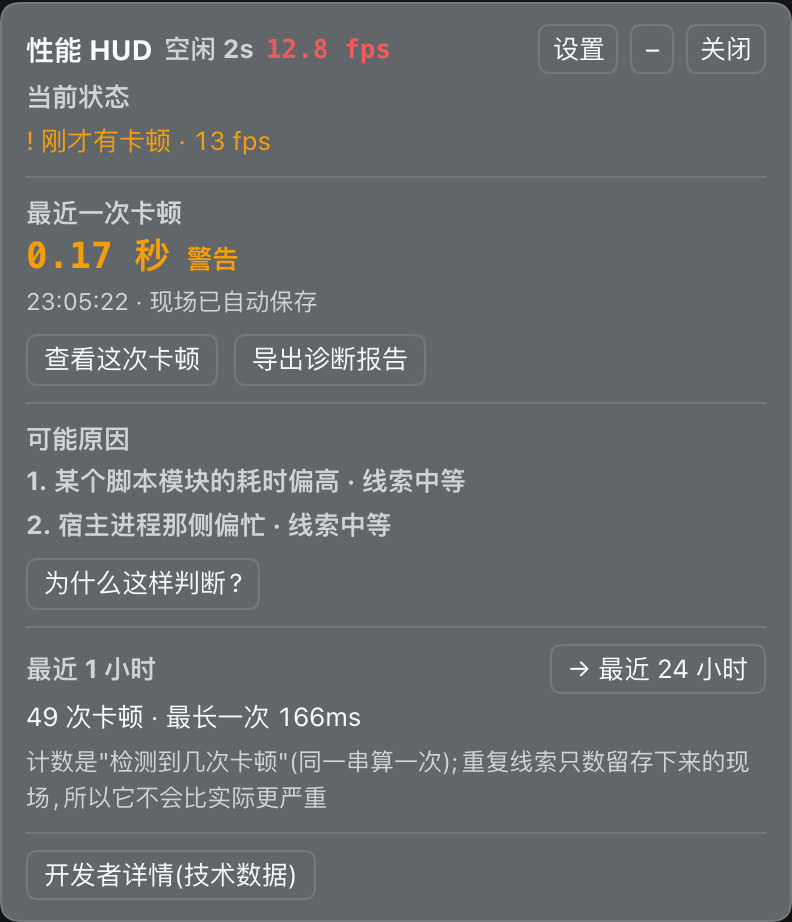
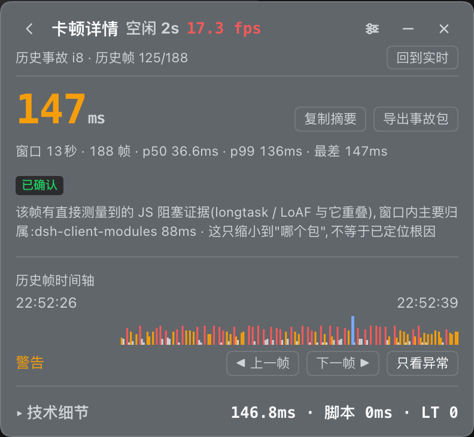
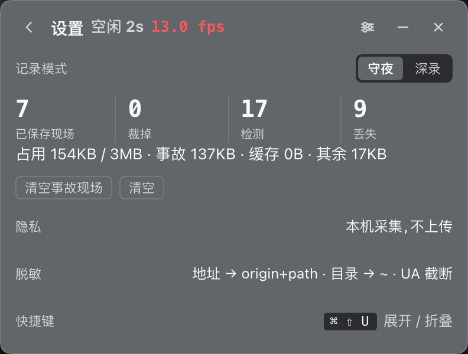

# dsh-perf-hud

> **纯客户端性能 HUD**:右下角一块浮层,回答"现在卡不卡、卡在谁身上"。
> 帧 · Longtask(四条腿归因)· 每插件回调耗时 · DOM 增长与写入者 · JS 堆 · 宿主 event-loop 与链路;
> **守夜层**默认常开:偶发卡顿自动留存最差几次,连证据一次性导出。

<p>


</p>

<p align="center">🌏 <b>中文</b> · <a href="./README_EN.md">English</a></p>

## 先看这里:你是哪类读者

| 你想做什么 | 从哪开始 |
|---|---|
| **第一次装**,想知道装完看什么 | [安装](#安装) → [三种模式](#三种模式) → [面板怎么读](#面板怎么读) |
| **读别人发来的包**,或把这包交给 AI | [诊断包](#诊断包) → [诊断 Skill](skills/dsh-perf-diagnosis/SKILL.md) → [导出包契约](docs/pack-schema.md) |
| **改代码 / 发版** | [AGENTS.md](AGENTS.md)(规则与门禁)· [CONTRIBUTING.md](CONTRIBUTING.md)· [REVIEW.md](REVIEW.md)(门槛与债) |

完整文档地图:[docs/README.md](docs/README.md)。

## 它回答什么问题

| 问题 | 面板给的答案 |
|---|---|
| 现在顺不顺? | FPS / 最差帧;标题栏常显「流式 / 空闲 Ns」作为解读前提 |
| 卡的那一下是谁干的? | Longtask 明细 + 四条腿归属(组件 / 包 / DOM 写入者) |
| 哪个插件在偷偷跑? | 按插件的回调速率(/s)、峰值、同步耗时;DOM 写入次数与写入者 |
| 是插件的问题还是宿主 / 链路? | 宿主 event-loop p50/p99/max + 链路 RTT / 吞吐,附判色与「链路已排除」结论 |
| 关掉某个插件到底有没有用? | 隔离实验(`__perfHud.experiment()`,控制台;不给默认入口) |

与 DSH 自带**开发者工具**的分工:它是前台显微镜(断点 / Host console / 网络 / Cordis 树 / Host CPU),**不给页面渲染 trace 与帧数据**;本插件是常开记录器(刚刚那一下多慢、是谁、能不能复盘)。两边不互相依赖,事故包里的 `devtools-trace` 缺失照实保留。快捷键 `Cmd/Ctrl+Shift+U` 展开/收起(macOS / Windows;Linux Web 未绑定)。

## 三种模式

| 模式 | 什么时候 | 做什么 | 成本 |
|---|---|---|---|
| **守夜**(默认常开) | 一直 | 帧级环形缓冲 + LoAF;自动留存**最差 10 次 + 每天最差 1 条(最多 7 天)+ 最近 3 次**并落盘 | 零插桩:只挂本来就在跑的 rAF 与两个 `PerformanceObserver` |
| **现场**(展开面板) | 想看一眼 | 五个问题在主界面;技术数据进开发者详情五页签(帧与归因 / DOM 与堆 / 宿主与链路 / 工具箱 / 原始数据) | 可忽略 |
| **深录**(显式打开) | 要抓全 | 才开原型插桩(DOM 写入 1/10 采样 + 调度点抓栈)与精确归因 | 有代价,必须显式开 |

守夜层要记住的四件事(细则见 [读数口径](docs/reading-panel.md)):

- 一帧 > **100ms**(或 LoAF blocking > 100ms)就自动抓**前 10 秒 + 后 3 秒**原样切片;标签页隐藏造成的几百秒"间隙"标成 `gap`,不算卡顿。
- **"发生了几次"和"留了几份现场"是两个数**:`检测到`(同一串触发只算一次)/ `已保存`(受容量限制)/ `丢失`。面板药丸上那格是"检测 N 次"(最近 24 小时,跨刷新),**不是**留存份数。
- 落盘 **3MB** 上限,超了从最弱的开始裁(裁掉几条写在常显那行);刷新、重启浏览器之后还在,`watch().restored` 说读回了几条。
- 这一层**不包装任何原型**;深录才装插桩(`applyProbeState()`),`disable()` 后原型方法原样还原。

## 看一眼:四屏与走法

| **主界面**(默认) | **卡顿详情** | **设置** |
|---|---|---|
|  |  |  |

开发者详情五个页签的样子在 [docs/images/](docs/images/)(截图由 `node tools/shots.mjs` 生成,要本机 `dsh web`;**图片不进 npm 包**,npm 页面上会是空图)。

1. **展开**:点药丸上的 `+` → 主界面;折叠时那颗药丸写着 fps / 最差帧 / 最近 24 小时检测到几次。
2. **看那一次卡顿**:点主界面整块事故行(左边琥珀色竖条)→ 卡顿详情;这一屏默认只给结论与时间轴,想看这一帧的时间去向就展开「▸ 技术细节」。
3. **看技术数据**:主界面底部「开发者详情(技术数据)」→ 五个页签(「深录」是页签行右侧的开关);标题栏齿轮 → 设置页。
4. **交给 AI**:事故行右侧下载图标 → 先出**预览卡**(四份文件 + 压缩包大小 + 「备注:已置空」)→「生成并导出」。
5. **本机排查**:开发者详情 · 原始数据里的「完整技术导出(保留备注)」**保留**你手敲的备注 —— 不是脱敏件,别直接交出去。

## 安装

```sh
dsh plugin --profile web add dsh-perf-hud
```

装完刷新页面即可看到右下角浮层(标题栏可拖动、位置会记住;双击回右下角)。改动生效方式:`client.js` 与其分片 `client.*.js` → 刷新页面(只改分片时先 `touch client.js`,rev 才更新);`index.js` → 重启宿主;`package.json` 的 `dsh.*` → 重装或重启。

> 宿主半是**可选**的:它没加载时面板照常工作,只是「宿主 event-loop」「宿主事件到达」显示不可用并写明原因 —— 不假装成功。

### 在哪些 DSH 版本上真跑过

只列**在本机真跑过五个真页面验收器**的版本 —— 1.0 起"声明即已验证":矩阵在 `package.json#dsh.compatibility.dshReleases`,`npm run pack:check` 逐条对着 [1.0 验收档案](docs/plans/2026-11-07-v1-acceptance.md) 的机器标记核,声明了却没跑过的版本会红。

| DSH | 验收时间 | 五个真页面验收器 |
|---|---|---|
| `0.2.1-rc.3` | 2026-11-07 | 全绿 |
| `0.2.1-rc.1` | 2026-10-19 ~ 11-04 | 全绿 |

`engines.dsh` 的范围更宽(`>=0.2.0-rc.2 <0.3.0-0`)—— 那是"装上不会崩"的边界,不等于"这一版我们跑过"。

## 面板怎么读

完整口径(场景标签 / 帧严重度 / 归因 / 缺失 / 回放 / 记录器可靠性)在 [docs/reading-panel.md](docs/reading-panel.md);布局与文案规则在 [docs/panel-rules.md](docs/panel-rules.md)。上手只需要六条:

1. **先看标题栏的场景标签**(`流式` / `空闲 Ns`),它是解读所有数字的前提;空闲基线要 60 秒净增为 0 才算真的空闲。
2. **帧严重度只有一个口径**:`max(blocking, 帧时长)` —— 判据、排序、标签共用同一个函数;`blocking = 0` 不等于没卡。
3. **每条证据都标出处**:直接测量 / 归因推断 / 无法确认三档;不会把推断写成"根因"。
4. **缺什么会写出来**:`context.missing` 按 `前缀:说明` 给(如 `precise:`、`loaf-pkg:`、`host-snapshot:`),前缀表由 [诊断 Skill §2.6](skills/dsh-perf-diagnosis/SKILL.md) 定义、`tools/gen-prefix-table.mjs` 生成。
5. **实时与历史是两个上下文**,分流只在 `detailContext()` 一处:详情区第一行会写明 `实时监控 · 当前帧` 还是 `历史事故 i12 · 历史帧 3/305`,不混数据源。
6. **取值卡的那一条**:工具箱清单按严重度排(索引 0 最差);「看这一帧」会把上下文切到历史事故,数据全部来自事故包,所以跨会话读回也能逐帧回放。

## 诊断包

四个文件、固定顺序(`manifest.json` 是入口):[导出包契约](docs/pack-schema.md) 冻结了全部键与版本策略,`tests/compat.mjs` 保证上一版的包仍读得出来。

| 文件 | 用处 |
|---|---|
| `manifest.json` | 格式版本、采集档位、**能力矩阵**(哪一层采到了 / 没采到 / 为什么)、脱敏声明、不含什么 |
| `summary.md` | 人读摘要,固定五段:摘要 / 最可能的假设 / 缺失的证据 / 下一步验证 / 元信息 |
| `incident.json` | 结构化原始证据(帧 / LoAF / 窗口内 longtask / 交互 / 环境 / 跨会话基线);宿主 CPU 采样与帧环重叠时另带 `timeline[]`(可选,回答这一段卡在宿主还是页面;来源可以是手动采样 / 武装窗口 / 设置页那个**默认关**的后台采样,每段带 `armed` 或 `mode: "ambient"`) |
| `README.md` | 这份包是什么、隐私口径 |

- **导出前先预览**:写着将要包含什么、脱了什么、少了什么;**给 AI** 的那条会把自由文本(你敲的备注)置空并标 `noteDropped: true`,完整导出保留。
- **脱敏是减法,不是匿名化**:页面地址只留 origin + path(查询串整段丢);脚本 URL 去协议与主机、保留 `rev`;敏感参数的值换 `<redacted>`;`/Users/<名>` 换 `~`;UA 只留主版本 + 系统。本来就没采:聊天正文、提示词、Cookie、Token、请求头 —— **正文只读字符数、不读内容**(打开 / 切换耗时那一层要判断"正文到了没有",读一次 `textContent.length`),其余层不碰正文 DOM。`context.redaction` 三个数组如实交代做了什么、没做什么。
- **本地回放(仓库内)**:`preview/replay.html` 拖进 zip / incident.json 就能看 —— 帧条、按包、可疑脚本、longtask,并**并列显示**"包内 summary"与"回放器从 frames 现算"的逐项差异(不一致直接标红)。离线断言见 `tests/replay.mjs`。
- **宿主 + 页面同一时间轴**:先 `__perfHud.cpuProfile(5)` 采一段宿主 CPU,复现卡顿后导出那条事故 —— `incident.timeline[0].share.hostPct` 给「宿主占比 X%」,`host.samples[]` / `frames[]` 是两段可复核的原始序列(只给百分比不算完)。验收命令:`node tools/check-timeline.mjs`。
- **人读一份事故**:`node tools/inspect-incident.mjs <file.json>`(帧条带 / 窗口内 longtask / LoAF / 按耗时排序的脚本);**交给 AI**:直接给它那份 `-ai.zip` —— 随包发货的 [诊断 Skill](skills/dsh-perf-diagnosis/SKILL.md) 会按 §2.1 的字段表与 §2.6 的前缀表读它。

## 控制台 API 与存储键位

| API | 作用 |
|---|---|
| `watch()` / `incidents()` / `report(id)` / `exportIncident(id)` | 守夜状态 / 事故摘要(索引 0 最差) / 完整事故对象 / 下载 JSON |
| `capture(note)` / `clearIncidents()` | 手动标记"刚刚卡了"(自动回退 3 秒,返回值说清留在哪条)/ 只清事故 |
| `snapshot()` / `exportJson()` | 整机导出件:读数 + 能力矩阵 + 脱敏声明 + 面板错误账本 |
| `capabilities()` / `causes(id)` / `pack(id, opts)` | 能力矩阵 / 候选原因(带支持与限制)/ 诊断包(不下载) |
| `enable()` / `disable()` / `setPrecise(on)` / `setDeep(on)` | 总开关 / 精确归因 / 深录(会装插桩) |
| `mark(note)` / `tally(ms)` / `stress(nodes, burnMs)` | 场景标记 / 计数窗口 / 渲染型卡顿自测(三条腿各测到什么) |
| `hostEvents(on)` / `experiment()` / `abortExperiment()` | 宿主事件延迟开关 / 隔离实验启停 |
| `openCost()` | 打开 / 切换会话的 ring(最近 20 次)+ p50/p95 + 当前等待进度(只读字符数,不含会话标题 / ID) |

`localStorage` 键位(`dsh-perf-hud:` 前缀):`:ring:v1` 帧环、`:tally:v1` 计数桶、`:on` / `:deep` / `:precise`(这三个才改变采集成本)、`:collapsed` / `:groups` / `:view:v1`(界面状态,不含读数)、`:incidents:v1` / `:watchui:v1` / `:sessions:v1`(留存与基线)、`:map:<rev>:<len>`(sourcemap 分段表,只留最近 8 个 rev)。

## 风险与边界(必读)

- **测量别人,自己必须便宜**:默认档零插桩;深录显式打开,关掉后原型方法**原样还原**(有断言)。
- **四条腿是下界**:事件处理器 / Promise / 微任务不在调度点插桩里,命中率会被 DOM 写入腿抬高 —— 必须配合名字分布读。
- **页面内拿不到的东西不假装有**:帧内执行顺序、原始源码(TS/TSX)行号、函数级时间轴、合成 / 光栅 / GPU 拆分、完整 Chrome trace —— 都写进 `capabilities().unobserved` 或 `missing`。
- **默认档看不到文件与行号**:合并批的包名与位置要靠精确归因(深录)现算;老包会照实写 `text-pending` / `precise-off`。
- **跨会话基线只是粗参照**:会话之间负载、视口、是否插桩都不同,别看一列数字就下"变慢了"的结论。
- **不本地发版之外的动作**:写盘只进 `localStorage`;不写 profile、不碰 `cordis.patch.yml`。

## 开发与测试

```sh
node tests/attribution.mjs   # 11 条:脚本 URL 形状 → 包名 / bundle key
node tests/logic.mjs         # 774 条:从 client.js 与其分片抽真函数进沙箱 + 静态检查 + 长度预算 + 契约冻结
node tests/host.mjs          # 71 条:用假 ctx 驱动真实 index.js
node tests/compat.mjs        # 17 条:上一版 schemaVersion 的夹具包喂当前读方
node tests/replay.mjs        # 9 条:回放站读包,现算摘要与包里 summary 逐项一致
node tools/render-smoke.mjs  # 离线渲染冒烟:六个屏 + 关闭态各渲染一遍(不需要浏览器)
node tools/gen-prefix-table.mjs --check  # 诊断 Skill §2.6 的前缀表与 capabilityMissing() 一致
# 882 条断言 + 一条冒烟,离线,无需 DSH 在跑;npm test 一条命令跑完
```

改到面板渲染 / `apply()` / `start()` 时**再跑一次真页面验收**(要浏览器 + 本机 `dsh web`,不进 CI):`node tools/check-panel.mjs`(必跑),`check-incident` / `check-counts` / `check-storage` / `check-interaction` 视改动。规则、提交规范、状态四片与全部门禁见 [AGENTS.md](AGENTS.md);供应链与发版门槛见 [REVIEW.md](REVIEW.md)。

## 参与贡献

欢迎报 bug 与提 PR。提交前跑完上面五套离线断言 + 渲染冒烟,并读 [CONTRIBUTING.md](CONTRIBUTING.md) 与 [AGENTS.md](AGENTS.md)。变更历史见 [CHANGELOG.md](CHANGELOG.md);历史决策与实测证据在 [docs/plans/](docs/plans/)(不是必读)。

## License

MIT
