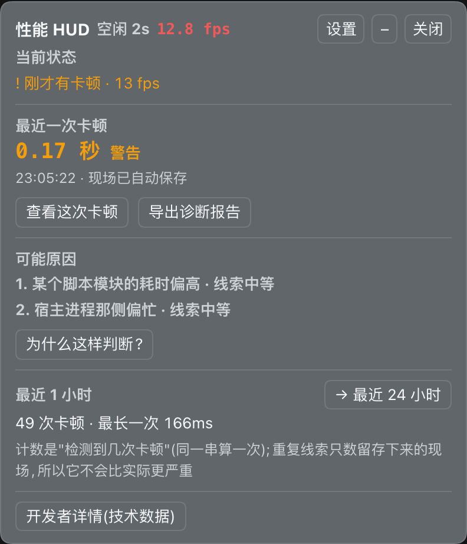
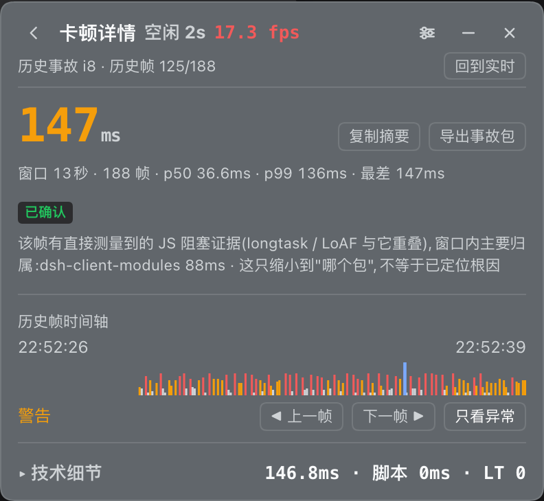
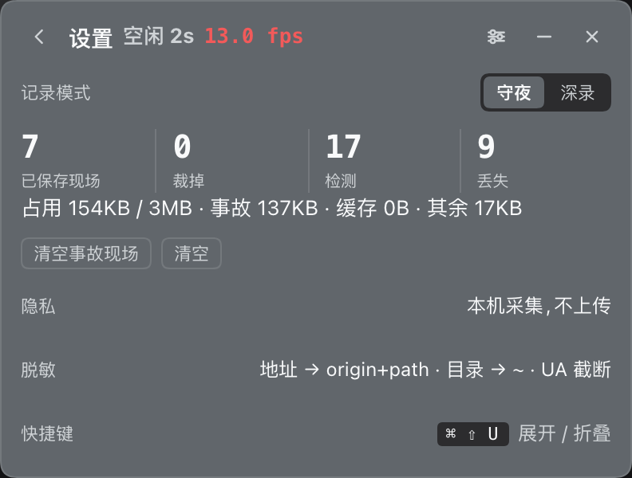

# dsh-perf-hud

> **Client-side performance HUD**: a floating panel in the bottom-right corner that answers *is it janky right
> now, and whose fault is it?* Frames · long tasks (four-leg attribution) · per-plugin callback cost · DOM growth
> and writers · JS heap · host event loop & link RTT · an always-on **night-watch** recorder that keeps the worst
> few stalls and exports the evidence in one pack.

<p>


</p>

<p align="center">🌏 <a href="./README.md"><b>中文</b></a> · <b>English</b></p>

Docs are maintained in Chinese — [README.md](README.md) is the primary version, this page is a summary.

## Which reader are you?

- **Installing it?** → [Install](#install) → [Three modes](#three-modes) → [Reading the panel](#reading-the-panel)
- **Reading a pack (or handing one to an AI)?** → [Diagnostic pack](#diagnostic-pack) → [diagnosis Skill](skills/dsh-perf-diagnosis/SKILL.md) → [pack contract](docs/pack-schema.md)
- **Working on the code / releasing?** → [AGENTS.md](AGENTS.md) (rules & gates) · [CONTRIBUTING.md](CONTRIBUTING.md) · [REVIEW.md](REVIEW.md) (gates & debts)

Full document map: [docs/README.md](docs/README.md).

## What it answers

| Question | The panel's answer |
|---|---|
| Is it smooth right now? | FPS / worst frame; the title bar always shows `streaming` / `idle Ns` as the precondition |
| Who caused that stall? | long-task details plus four-leg attribution (component / package / DOM writer) |
| Is some plugin busy? | per-plugin callback rate (/s), peak and sync time; DOM write counts and writers |
| Plugin, host or link? | host event-loop p50/p99/max and link RTT/throughput, with thresholds and a "link ruled out" verdict |

Split with the built-in DSH **developer tools**: they are the foreground microscope (breakpoints / host console /
network / Cordis tree / host CPU) and expose **no rendering trace or frame data**; this plugin is the always-on
recorder (how slow that stall was, who, can it be replayed). The `devtools-trace` gap in the pack stays honestly
reported. Shortcut `Cmd/Ctrl+Shift+U` toggles the panel (macOS / Windows; not bound on Linux Web).

## Three modes

| Mode | When | What | Cost |
|---|---|---|---|
| **Night watch** (default on) | Always | per-frame ring buffer + LoAF; auto-keeps the **worst 10 + daily worst (7 days) + 3 most recent** and persists them | zero instrumentation: only the rAF loop and two `PerformanceObserver`s |
| **Live** (panel open) | When curious | the five questions on the main screen; technical data behind five dev tabs | negligible |
| **Deep record** (explicit) | Need everything | instrumentation (1/10 DOM-write sampling, scheduler stacks) + precise attribution | has a cost; must be turned on |

Four things to remember about night watch (full details in [reading-panel](docs/reading-panel.md)):

- a frame over **100ms** (or LoAF blocking over 100ms) is sliced automatically: **10s before + 3s after**;
  multi-second "gaps" from a hidden tab are tagged `gap` and are not stalls;
- **"how often it happened" and "how many scenes were kept" are different numbers**: `detected` (a burst counts
  once) / `saved` (capacity-limited) / `lost`. The collapsed pill shows *detected in 24h*, not the kept count;
- persistence is capped at **3MB** (trims the weakest first and says how many); kept incidents survive a reload
  (`watch().restored`). This layer **patches nothing** — only deep record installs wrappers, and `disable()` restores them.

## At a glance: four screens and how to reach them

  

All five dev tabs are shown in [docs/images/](docs/images/) (generated by `node tools/shots.mjs`, needs a local
`dsh web`; **images are not shipped in the npm package**, so they are blank on the npm page).

1. **Expand**: click `+` on the pill → main screen; the pill reads fps / worst frame / stalls seen in 24h.
2. **Replay that stall / see technical data**: click the whole stall row → stall detail (expand "▸ technical details"
   for where that frame went); "developer details" at the bottom of the main screen → five tabs (deep record is the
   switch on the tab row); the gear in the title bar opens settings.
3. **Hand it to an AI**: the download icon on the stall row → preview card (four files + zip size + "notes: blanked")
   → "generate and export".
4. **Local debugging**: "full technical export" under dev details · raw data **keeps** your note — it is not the
   redacted pack, do not hand it out.

## Install

```sh
dsh plugin --profile web add dsh-perf-hud
```

Reload the page to see the panel (drag the title bar to move; double-click to reset). Changes take effect:
`client.js` / shards → reload the page (`touch client.js` after editing a shard only); `index.js` → restart the
host; `package.json#dsh.*` → reinstall or restart. The host half is **optional**: without it the panel still works
and marks host event-loop / host events as unavailable with the reason — it never fakes success.

### DSH compatibility (verified, not just declared)

Only versions where all **five real-page verifiers** passed on a local `dsh web` are listed. Since 1.0,
`package.json#dsh.compatibility.dshReleases` is checked against the machine markers in the
[1.0 acceptance archive](docs/plans/2026-11-07-v1-acceptance.md) by `npm run pack:check`; a declared but never
run version fails the gate.

| DSH | Verified | Five real-page verifiers |
|---|---|---|
| `0.2.1-rc.3` | 2026-11-07 | all green |
| `0.2.1-rc.1` | 2026-10-19 ~ 11-04 | all green |

`engines.dsh` is wider (`>=0.2.0-rc.2 <0.3.0-0`): that is the "it loads" boundary, not "we ran on it".

## Reading the panel

Full conventions (scenario label / frame severity / attribution / missing / replay / recorder reliability) in
[reading-panel](docs/reading-panel.md); layout and copy rules in [panel-rules](docs/panel-rules.md). Six rules to
start with:

1. **Read the scenario label first** (`streaming` / `idle Ns`) — every number is interpreted against it.
2. **One severity definition**: `max(blocking, frame duration)` — judgement, ordering and labels share one function.
3. **Every piece of evidence carries provenance**: measured / inferred / unknown. Inferences are never written as root causes.
4. **Missing evidence is spelled out**: `context.missing` lines are `prefix: reason` (`precise:`, `loaf-pkg:`, …); the
   prefix table is generated from `capabilityMissing()` into the [diagnosis Skill §2.6](skills/dsh-perf-diagnosis/SKILL.md).
5. **Live and historical are two contexts**, switched only in `detailContext()`; the detail header says which one you are in.
6. **The kept list is ordered by severity** (index 0 = worst); "view this frame" switches to the historical context and
   everything is read from the pack — so cross-session incidents replay frame by frame.

## Diagnostic pack

Four files in a fixed order (`manifest.json` first). The [pack contract](docs/pack-schema.md) freezes every key and
the version policy; `tests/compat.mjs` proves packs from the previous schema version still read.

| File | Purpose |
|---|---|
| `manifest.json` | format version, capture tier, **capability matrix** (what was captured / missing / why), redaction statement, what is not included |
| `summary.md` | human summary in five fixed sections (summary / candidate causes / missing evidence / next steps / meta) |
| `incident.json` | structured evidence (frames / LoAF / window long tasks / interactions / env / cross-session baselines); when a host CPU profile overlaps the window it also carries `timeline[]` (optional: host vs page share) |
| `README.md` | what this pack is, privacy stance |

- **Preview before export**: it lists what will be included, redacted and missing. The **"for AI"** export blanks free
  text (your note) and sets `noteDropped: true`; the full export keeps it.
- **Redaction is subtraction, not anonymisation**: page URLs keep origin + path only; script URLs drop protocol/host and
  keep `rev`; secret parameter values become `<redacted>`; `/Users/<name>` becomes `~`; UA keeps major version + OS.
  Chat text, prompts, cookies, tokens and headers are **never collected**. `context.redaction` states all three lists.
- **One timeline for host + page**: run `__perfHud.cpuProfile(5)`, reproduce the stall, then export that incident — `incident.timeline[0].share.hostPct` gives the host share, with the raw `host.samples[]` / `frames[]` sequences alongside. Acceptance: `node tools/check-timeline.mjs`.
- **Read one incident**: `node tools/inspect-incident.mjs <file.json>`; **hand it to an AI**: send the `-ai.zip` — the
  bundled [diagnosis Skill](skills/dsh-perf-diagnosis/SKILL.md) reads it by its field table and prefix table.

## Console API and storage keys

| API | Purpose |
|---|---|
| `watch()` / `incidents()` / `report(id)` / `exportIncident(id)` | night-watch state / stall summaries (index 0 = worst) / full incident / download JSON |
| `capture(note)` / `clearIncidents()` | manually mark "it just stuttered" (3s look-back; the return value says where it landed) / clear incidents only |
| `snapshot()` / `exportJson()` | full machine export: readings + capability matrix + redaction statement + panel error ledger |
| `capabilities()` / `causes(id)` / `pack(id, opts)` | capability matrix / candidate causes (with support & limits) / the pack without downloading |
| `enable()` / `disable()` / `setPrecise(on)` / `setDeep(on)` | master switch / precise attribution / deep record (installs instrumentation) |
| `mark(note)` / `tally(ms)` / `stress(nodes, burnMs)` | scenario mark / counter window / synthetic render-stall self-test (three legs) |
| `hostEvents(on)` / `experiment()` / `abortExperiment()` | host event-latency watch / isolation experiment on & off |

`localStorage` keys (`dsh-perf-hud:` prefix): `:ring:v1` frame ring, `:tally:v1` counters, `:on` / `:deep` / `:precise`
(the three that change capture cost), `:collapsed` / `:groups` / `:view:v1` (UI state, no readings),
`:incidents:v1` / `:watchui:v1` / `:sessions:v1`, `:map:<rev>:<len>` (sourcemap sections, last 8 revs).

## Risks and boundaries (read this)

- **It measures other code, so it must stay cheap**: zero instrumentation by default; deep record is explicit and its
  wrappers are reversible (asserted). **Four legs are a lower bound** — event handlers / promises / microtasks are not at
  the scheduler probe, and the DOM-write leg inflates the hit rate: read it with the name distribution.
- **What the page cannot see is not faked**: in-frame execution order, original source (TS/TSX) lines, function-level
  timelines, compositor / raster / GPU splits, full Chrome traces — all reported in `capabilities().unobserved` or `missing`.
- **The default tier has no file/line** (merged batches need precise attribution; old packs say `text-pending` /
  `precise-off`); **cross-session baselines are rough references**, not regression verdicts.
- **No writes outside `localStorage`**: no profile state, `cordis.patch.yml` untouched.

## Development

```sh
node tests/attribution.mjs   # 11 assertions: script URL shapes → package name / bundle key
node tests/logic.mjs         # 728 assertions: real functions extracted from client.js + static checks + coverage of the frozen contract
node tests/host.mjs          # 56 assertions: real index.js driven by a fake ctx
node tests/compat.mjs        # 17 assertions: a previous-schemaVersion pack fed to the current readers
node tests/replay.mjs        # 9 assertions: the replay site re-derives the summary from frames and matches the pack
node tools/render-smoke.mjs  # offline render smoke: six screens + "HUD off", no browser needed
node tools/gen-prefix-table.mjs --check  # diagnosis Skill §2.6 prefix table in sync with capabilityMissing()
# 821 assertions + one smoke run, no running DSH required; `npm test` runs them all
```

Any change to rendering / `apply()` / `start()` also needs a **real-page** pass (`node tools/check-panel.mjs` at
minimum; `check-incident` / `check-counts` / `check-storage` / `check-interaction` as relevant — browser + a local
`dsh web`, not in CI). Rules, commit conventions, the four state slices and every gate: [AGENTS.md](AGENTS.md);
supply-chain and release gates: [REVIEW.md](REVIEW.md).

## Contributing

Bug reports and PRs are welcome. Run the four offline suites plus the render smoke before pushing, and read
[CONTRIBUTING.md](CONTRIBUTING.md) and [AGENTS.md](AGENTS.md). Changelog: [CHANGELOG.md](CHANGELOG.md); historical
decisions and measurements live in [docs/plans/](docs/plans/) (not required reading).

## License

MIT
