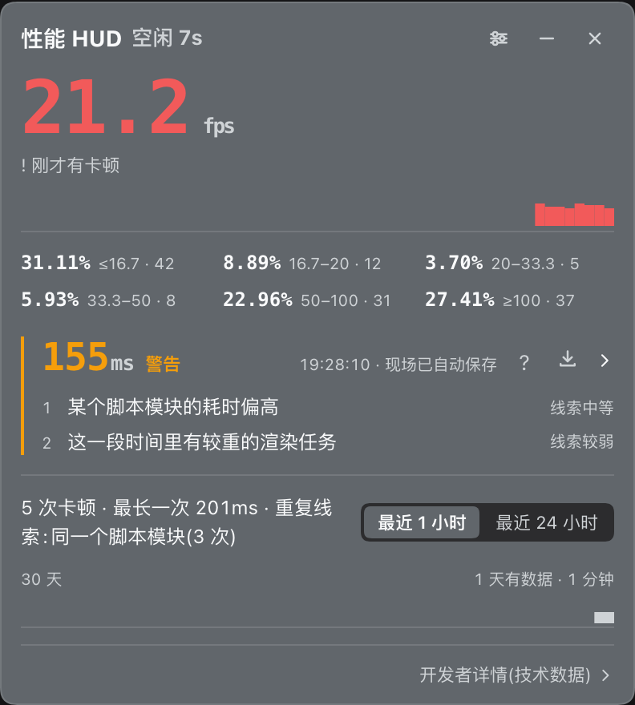
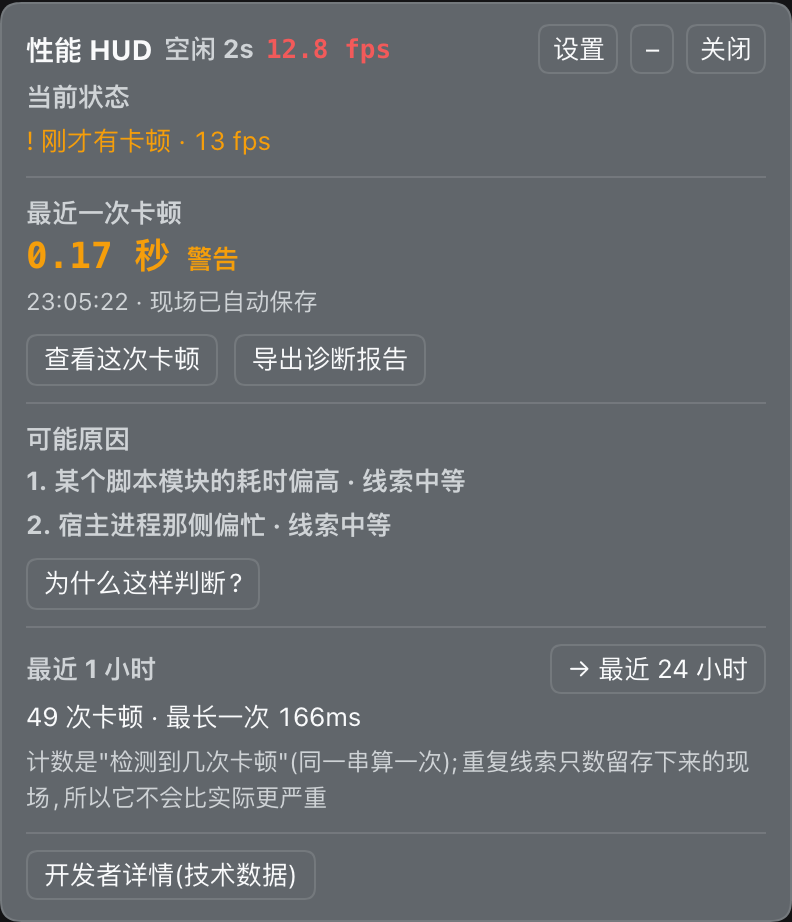
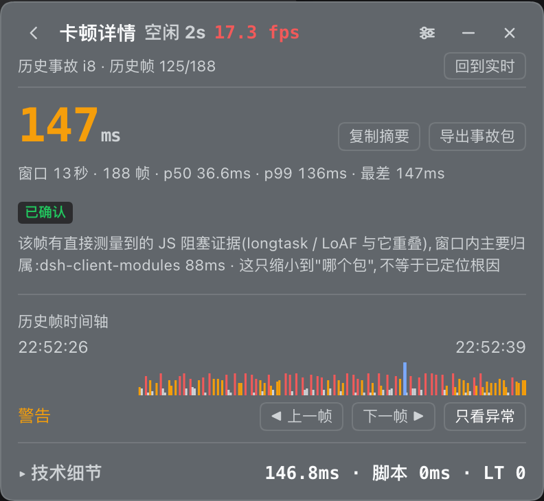
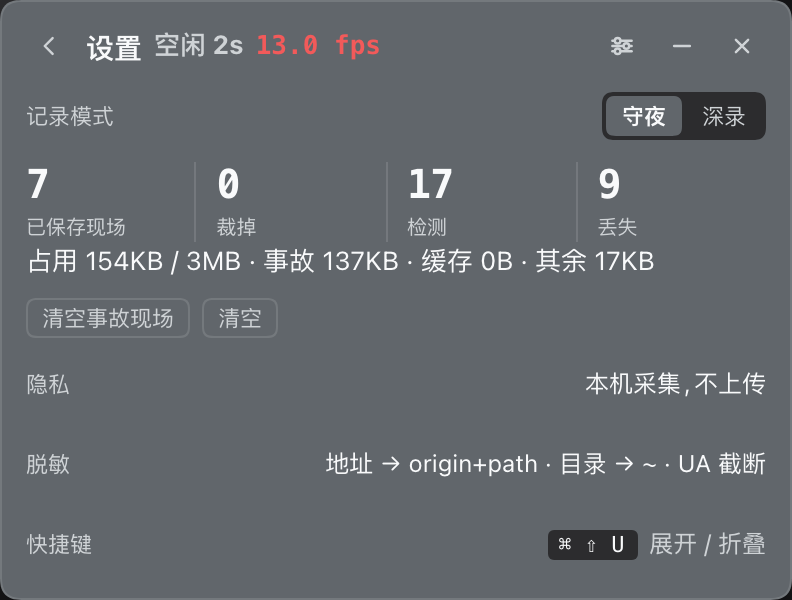

# dsh-perf-hud

> **Client-side performance HUD**: a floating panel in the bottom-right that answers *is it janky right now, and
> whose fault is it?* Frames · long tasks (four-leg attribution) · per-plugin callback cost · DOM growth and writers ·
> JS heap · host event loop & link RTT · an always-on **night-watch** recorder that keeps the worst stalls and exports the evidence in one pack.

<p>  </p>

<p align="center">🌏 <a href="https://github.com/yanzhaohui1999/dsh-perf-hud/blob/main/README.md"><b>中文</b></a> · <b>English</b></p>

## Install

```sh
dsh plugin --profile web add dsh-perf-hud
```

Reload the page to see the panel (drag the title bar to move; double-click to reset). Changes take effect:
`client.js` / shards → reload the page (`touch client.js` after editing a shard only); `index.js` → restart the
host; `package.json#dsh.*` → reinstall or restart. The host half is **optional**: without it the panel still works
and marks host event-loop / host events as unavailable with the reason — it never fakes success.

Docs are maintained in Chinese — [README.md](https://github.com/yanzhaohui1999/dsh-perf-hud/blob/main/README.md) is the primary version, this page is a summary.

### DSH compatibility (verified, not just declared)

Only versions where all **five real-page verifiers** passed on a local `dsh web` are listed. Since 1.0,
`package.json#dsh.compatibility.dshReleases` is a release-process ledger, **not a runtime compatibility contract** (DSH does not read it at runtime). It is checked against the machine markers in the
[1.0 acceptance archive](https://github.com/yanzhaohui1999/dsh-perf-hud/blob/main/docs/plans/2026-11-07-v1-acceptance.md) by `npm run pack:check`; a declared but never
run version fails the gate.

| DSH | Verified | Five real-page verifiers |
|---|---|---|
| `0.2.1-rc.3` | 2026-11-07 | all green |
| `0.2.1-rc.1` | 2026-10-19 ~ 11-04 | all green |

`engines.dsh` is wider (`>=0.2.0-rc.2 <0.3.0-0`): that is the "it loads" boundary, not "we ran on it".

## Why this exists

With DSH, the chat panel sometimes freezes without warning — typing lags, scrolling drops frames — and you cannot tell whether it is the browser, the host, or one plugin eating the main thread. Browser DevTools will tell you "that frame took 155ms", but not which layer it went to: which plugin, which component, which DOM write, or the host event loop. By the time you go looking, the stall is over and nothing was kept.

So the main thing here is not a dashboard but a dashcam: it watches with zero instrumentation, keeps the 10s before + 3s after any frame over 100ms, retains the worst frames by severity, and lets you replay them frame by frame, attribute them to packages, and export the evidence in one pack. When you open the panel, it answers five questions: is it smooth right now, how slow was that stall, who might be responsible, what is the trend, and what to check next.

<p align="center"></p>
<p align="center"><sub>Real capture: a 21.2 fps page; the latest 155ms stall was saved automatically.</sub></p>

## Which reader are you?

- **Installing it?** → [Install](#install) → [Three modes](#three-modes) → [Reading the panel](#reading-the-panel)
- **Reading a pack (or handing one to an AI)?** → [Diagnostic pack](#diagnostic-pack) → [diagnosis Skill](https://github.com/yanzhaohui1999/dsh-perf-hud/blob/main/skills/dsh-perf-diagnosis/SKILL.md) → [pack contract](https://github.com/yanzhaohui1999/dsh-perf-hud/blob/main/docs/pack-schema.md)
- **Working on the code / releasing?** → [AGENTS.md](https://github.com/yanzhaohui1999/dsh-perf-hud/blob/main/AGENTS.md) (rules & gates) · [CONTRIBUTING.md](https://github.com/yanzhaohui1999/dsh-perf-hud/blob/main/CONTRIBUTING.md) · [REVIEW.md](https://github.com/yanzhaohui1999/dsh-perf-hud/blob/main/REVIEW.md) (gates & debts)

Full document map: [docs/README.md](https://github.com/yanzhaohui1999/dsh-perf-hud/blob/main/docs/README.md).

## What it answers

| Question | The panel's answer |
|---|---|
| Is it smooth right now? | FPS / worst frame; the title bar always shows `streaming` / `idle Ns` as the precondition |
| Who caused that stall? | long-task details plus four-leg attribution (component / package / DOM writer) |
| Is some plugin busy? | per-plugin callback rate (/s), peak and sync time; DOM write counts and writers |
| Plugin, host or link? | host event-loop p50/p99/max and link RTT/throughput, with thresholds and a "link ruled out" verdict |

Split with the built-in DSH **developer tools**: they are the foreground microscope (breakpoints / host console /
network / Cordis tree / host CPU) and expose **no rendering trace or frame data**; this plugin is the always-on
recorder (how slow that stall was, who, can it be replayed). The `devtools-trace` gap in the pack stays honestly
reported. Shortcut `Cmd/Ctrl+Shift+U` toggles the panel (macOS / Windows; not bound on Linux Web).

## Three modes

| Mode | When | What | Cost |
|---|---|---|---|
| **Night watch** (default on) | Always | per-frame ring buffer + LoAF; auto-keeps the **worst 10 + daily worst (7 days) + 3 most recent** and persists them | zero instrumentation: only the rAF loop and two `PerformanceObserver`s |
| **Live** (panel open) | When curious | the five questions on the main screen; technical data behind five dev tabs | negligible |
| **Deep record** (explicit) | Need everything | instrumentation (1/10 DOM-write sampling, scheduler stacks) + precise attribution | has a cost; must be turned on |

Four things to remember about night watch (full details in [reading-panel](https://github.com/yanzhaohui1999/dsh-perf-hud/blob/main/docs/reading-panel.md)):

- a frame over **100ms** (or LoAF blocking over 100ms) is sliced automatically: **10s before + 3s after**;
  multi-second "gaps" from a hidden tab are tagged `gap` and are not stalls;
- **"how often it happened" and "how many scenes were kept" are different numbers**: `detected` (a burst counts
  once) / `saved` (capacity-limited) / `lost`. The collapsed pill shows *detected in 24h*, not the kept count;
- persistence is capped at **3MiB** (judged on the JSON text's UTF-8 byte length; trims the weakest first and says how many); kept incidents survive a reload
  (`watch().restored`). This layer **patches nothing** — only deep record installs wrappers, and `disable()` restores them.

## New in 1.1

None of these changes the default capture tier: the armed window and host background sampling are opt-in, the other three record automatically.

**Armed window.** In stall detail (click a stall row on the main screen) press **Arm 60s**. For that window the client temporarily switches on deep record and precise attribution, and the host samples CPU in 10-second segments (up to 12); the next stall past the trigger line then carries `env.armed` and file and line, plus `incident.timeline[]` when the host is available. Timeout, Cancel, closing the HUD, or turning deep record off restores the tier you had before; a window with no stall adds no incident (host segments already collected stay in memory for the next export). Use the button, or `__perfHud.arm(60)` → `armed()` → `disarm()`. Without the host half the client still arms, and the row says "host sampling off".

**30-day trend.** No switch: while the HUD is on, frames are aggregated per calendar day — active minutes, p50/p99, worst frame, streaming/idle seconds, incident count — kept for 30 days in `dsh-perf-hud:history:v1`, with no raw frames and no use of the 3MiB incident budget. The sparkline appears below "trend" on the main screen once there is at least one day (bar height = that day's p99, capped at 500ms; hover for the numbers). Use it as it runs, or read `__perfHud.history()` / `context.history` in a pack. Quantiles are histogram bucket upper edges — a rough reference, not a regression verdict.

**Open / switch cost.** No switch: with the HUD on, clicking a session row that is not selected is timed until the transcript node is present, at least 1200 characters long, and the row is selected. The last 20 samples stay in memory only (a reload clears them), and one `open 1.4s` line appears under "trend" on the main screen. Only the character count is read — never the text, title, or session ID. Use it by clicking sessions as usual, or read `__perfHud.openCost()` for the ring, p50/p95 and the pending wait. Limits: clicks only (keyboard navigation is not timed), a 30s timeout, and single readings drift ±20–70ms between runs.

**Host background sampling.** Settings (the gear) → **Host background sampling**, off by default. When on, the host samples a 1s CPU profile every 5 minutes and keeps the last 3 segments (about 15 minutes); the client renews a lease every 10s, and closing the HUD, switching it off, or losing the lease stops it. It shares one profiler with manual sampling and the armed window (priority: manual > armed > background). Use the switch, or `__perfHud.ambient()` / `ambientOn()` / `ambientOff()`. Limits: the row is normally absent when the host does not advertise the op (restart the host after upgrading); a 1s segment often misses a stall, so `timeline[].mode:"ambient"` may simply be absent; sampling costs CPU, hence off by default.

**Visible freeze.** No switch: an rAF gap of at least 1000ms while the page is visible (with consistent clocks, or a long task / LoAF overlapping) is classified `visible-freeze` and captured. It stays `gap:true`, so `worstFrameMs` can still read 16.7ms; the pack carries `frames[].gapReason` and `summary.visibleFreezeMs / visibleFreezeFrames`, and the replay-scope line in stall detail says "visible freeze 2008ms". Hidden-tab gaps and sleep-like `time-jump`s are not counted. Open a stall or export a pack to see it; the same summary also adds `refreshHz` (estimated from non-gap intervals) and `budgetMisses` (frames over 1.5× the refresh budget).

Verification status: visible freeze and the single open-cost path were exercised on a real page; the armed window's host segments, background sampling's cost and coverage, and the 30-day trend over time are not real-machine verified yet — treat those readings as provisional (details in [CHANGELOG](https://github.com/yanzhaohui1999/dsh-perf-hud/blob/main/CHANGELOG.md)).

## At a glance: four screens and how to reach them

  

All five dev tabs are shown in [docs/images/](https://github.com/yanzhaohui1999/dsh-perf-hud/tree/main/docs/images)
(generated by `node tools/shots.mjs`, needs a local `dsh web`; screenshots are not shipped, so the README links
them by absolute URL and they render on both npm and GitHub).

1. **Expand**: click `+` on the pill → main screen; the pill reads fps / worst frame / stalls seen in 24h.
2. **Replay that stall / see technical data**: click the whole stall row → stall detail (expand "▸ technical details"
   for where that frame went); "developer details" at the bottom of the main screen → five tabs (deep record is the
   switch on the tab row); the gear in the title bar opens settings.
3. **Hand it to an AI**: the download icon on the stall row → preview card (four files + zip size + "notes: blanked")
   → "generate and export".
4. **Local debugging**: "full technical export" under dev details · raw data **keeps** your note — it is not the
   redacted pack, do not hand it out.

## Reading the panel

Full conventions (scenario label / frame severity / attribution / missing / replay / recorder reliability) in
[reading-panel](https://github.com/yanzhaohui1999/dsh-perf-hud/blob/main/docs/reading-panel.md); layout and copy rules in [panel-rules](https://github.com/yanzhaohui1999/dsh-perf-hud/blob/main/docs/panel-rules.md). Six rules to
start with:

1. **Read the scenario label first** (`streaming` / `idle Ns`) — every number is interpreted against it.
2. **One severity definition**: `max(blocking, frame duration)` — judgement, ordering and labels share one function.
3. **Every piece of evidence carries provenance**: measured / inferred / unknown. Inferences are never written as root causes.
4. **Missing evidence is spelled out**: `context.missing` lines are `prefix: reason` (`precise:`, `loaf-pkg:`, …); the
   prefix table is generated from `capabilityMissing()` into the [diagnosis Skill §2.6](https://github.com/yanzhaohui1999/dsh-perf-hud/blob/main/skills/dsh-perf-diagnosis/SKILL.md).
5. **Live and historical are two contexts**, switched only in `detailContext()`; the detail header says which one you are in.
6. **The kept list is ordered by severity** (index 0 = worst); "view this frame" switches to the historical context and
   everything is read from the pack — so cross-session incidents replay frame by frame.

## Diagnostic pack

Four files in a fixed order (`manifest.json` first). The [pack contract](https://github.com/yanzhaohui1999/dsh-perf-hud/blob/main/docs/pack-schema.md) freezes every key and
the version policy; `tests/compat.mjs` proves packs from the previous schema version still read.

| File | Purpose |
|---|---|
| `manifest.json` | format version, capture tier, **capability matrix** (what was captured / missing / why), redaction statement, what is not included |
| `summary.md` | human summary in five fixed sections (summary / candidate causes / missing evidence / next steps / meta) |
| `incident.json` | structured evidence (frames / LoAF / window long tasks / interactions / env / cross-session baselines); when a host CPU profile overlaps the window it also carries `timeline[]` (optional: host vs page share) |
| `README.md` | what this pack is, privacy stance |

- **Preview before export**: it lists what will be included, redacted and missing. The **"for AI"** export blanks free
  text (your note) and sets `noteDropped: true`; the full export keeps it.
- **Redaction is subtraction, not anonymisation**: page URLs keep origin + path only; script URLs drop protocol/host and
  keep `rev`; secret parameter values become `<redacted>`; `/Users/<name>` becomes `~`; UA keeps major version + OS.
  Chat text, prompts, cookies, tokens and headers are never collected — **only the transcript character count is read**
  (the open / switch cost layer needs to know whether the transcript has arrived, so it reads `textContent.length` once;
  the text itself is never kept, and no other layer touches the transcript DOM). `context.redaction` states all three lists.
- **One timeline for host + page**: run `__perfHud.cpuProfile(5)`, reproduce the stall, then export that incident — `incident.timeline[0].share.hostPct` gives the host share, with the raw `host.samples[]` / `frames[]` sequences alongside. Acceptance: `node tools/check-timeline.mjs`.
- **Read one incident**: `node tools/inspect-incident.mjs <file.json>`; **hand it to an AI**: send the `-ai.zip` — the
  bundled [diagnosis Skill](https://github.com/yanzhaohui1999/dsh-perf-hud/blob/main/skills/dsh-perf-diagnosis/SKILL.md) reads it by its field table and prefix table.

## Console API and storage keys

| API | Purpose |
|---|---|
| `watch()` / `incidents()` / `report(id)` / `exportIncident(id)` | night-watch state / stall summaries (index 0 = worst) / full incident / download JSON |
| `capture(note)` / `clearIncidents()` | manually mark "it just stuttered" (3s look-back; the return value says where it landed) / clear incidents only |
| `snapshot()` / `exportJson()` | full machine export: readings + capability matrix + redaction statement + panel error ledger |
| `capabilities()` / `causes(id)` / `pack(id, opts)` | capability matrix / candidate causes (with support & limits) / the pack without downloading |
| `enable()` / `disable()` / `setPrecise(on)` / `setDeep(on)` | master switch / precise attribution / deep record (installs instrumentation) |
| `mark(note)` / `tally(ms)` / `stress(nodes, burnMs)` | scenario mark / counter window / synthetic render-stall self-test (three legs) |
| `hostEvents(on)` / `experiment()` / `abortExperiment()` | host event-latency watch / isolation experiment on & off |
| `arm(seconds?)` / `armed()` / `disarm()` | armed window: temporary deep record + precise attribution + host segments; the next stall carries a timeline |
| `openCost()` | open / switch-session ring (latest 20) + p50/p95 + the pending wait (character count only, no title / ID) |
| `history(atMs?)` | 30-day daily aggregates (only days with samples; same source as the sparkline) |
| `ambient()` / `ambientOn()` / `ambientOff()` | host background sampling: status / on / off (off by default) |

`localStorage` keys (`dsh-perf-hud:` prefix): `:ring:v1` frame ring, `:tally:v1` counters, `:history:v1` 30-day aggregates (separate from the 3MiB incident budget), `:on` / `:deep` / `:precise`
(the three that change capture cost), `:ambient` (background sampling switch), `:collapsed` / `:groups` / `:view:v1` (UI state, no readings),
`:incidents:v1` / `:watchui:v1` / `:sessions:v1`, `:map:<rev>:<len>` (sourcemap sections, last 8 revs).

## Risks and boundaries (read this)

- **It measures other code, so it must stay cheap**: zero instrumentation by default; deep record is explicit and its
  wrappers are reversible (asserted). **Four legs are a lower bound** — event handlers / promises / microtasks are not at
  the scheduler probe, and the DOM-write leg inflates the hit rate: read it with the name distribution.
- **What the page cannot see is not faked**: in-frame execution order, original source (TS/TSX) lines, function-level
  timelines, compositor / raster / GPU splits, full Chrome traces — all reported in `capabilities().unobserved` or `missing`.
- **The default tier has no file/line** (merged batches need precise attribution; old packs say `text-pending` /
  `precise-off`); **cross-session baselines are rough references**, not regression verdicts.
- **No writes outside `localStorage`**: no profile state, `cordis.patch.yml` untouched.

## Development

```sh
node tests/attribution.mjs   # 11 assertions: script URL shapes → package name / bundle key
node tests/logic.mjs         # 806 assertions: real functions extracted from client.js + static checks + coverage of the frozen contract
node tests/host.mjs          # 100 assertions: real index.js driven by a fake ctx
node tests/compat.mjs        # 17 assertions: a previous-schemaVersion pack fed to the current readers
node tests/replay.mjs        # 9 assertions: the replay site re-derives the summary from frames and matches the pack
node tools/render-smoke.mjs  # offline render smoke: six screens + "HUD off", no browser needed
node tools/gen-prefix-table.mjs --check  # diagnosis Skill §2.6 prefix table in sync with capabilityMissing()
# 943 assertions + one smoke run, no running DSH required; `npm test` runs them all
```

Any change to rendering / `apply()` / `start()` also needs a **real-page** pass (`node tools/check-panel.mjs` at
minimum; `check-incident` / `check-counts` / `check-storage` / `check-interaction` as relevant — browser + a local
`dsh web`, not in CI). Rules, commit conventions, the four state slices and every gate: [AGENTS.md](https://github.com/yanzhaohui1999/dsh-perf-hud/blob/main/AGENTS.md);
supply-chain and release gates: [REVIEW.md](https://github.com/yanzhaohui1999/dsh-perf-hud/blob/main/REVIEW.md).

## Contributing

Bug reports and PRs are welcome. Run the four offline suites plus the render smoke before pushing, and read
[CONTRIBUTING.md](https://github.com/yanzhaohui1999/dsh-perf-hud/blob/main/CONTRIBUTING.md) and [AGENTS.md](https://github.com/yanzhaohui1999/dsh-perf-hud/blob/main/AGENTS.md). Changelog: [CHANGELOG.md](https://github.com/yanzhaohui1999/dsh-perf-hud/blob/main/CHANGELOG.md); historical
decisions and measurements live in [docs/plans/](https://github.com/yanzhaohui1999/dsh-perf-hud/tree/main/docs/plans/) (not required reading).

## License

MIT
