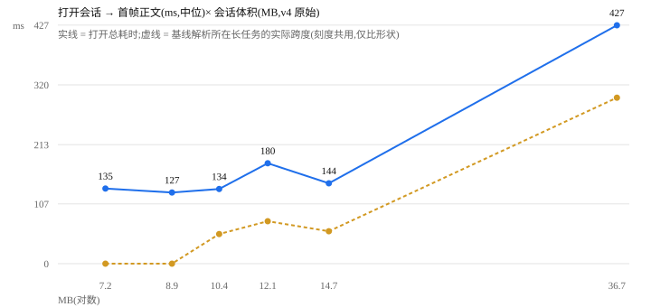

# A3:会话体积 → 打开耗时曲线

> **状态:已实测**(2026-11-08 02:09,Asia/Shanghai;分支 `feat/a3-open-cost`,基线 `b56991d`)。
> 工具 [`tools/measure-open-cost.mjs`](../../tools/measure-open-cost.mjs),一条命令复跑;
> 6 个体积点 × 每点 3 次(先热身 1 次),**18/18 拿到首帧正文**。
> 环境:本机 `dsh web`(`127.0.0.1:3080`,外壳 `index-BXV-oxvX.js`)+ headless Chrome `156.0.8078.80`
> (macOS arm64,Node `v26.12.0`,视口 1400×900)。
> **口径:同机同版本内可比;跨版本只比趋势,不比绝对值。**

## 1. 结论

1. **只有 36.73MB 是明显的台阶:427ms(中位)**。7–15MB 的五个点是 127–180ms,彼此差异与整轮重跑的漂移(±40ms 量级)同量级 —— **文件体积在 15MB 以下不是打开耗时的好预测**。
2. 时间花在**宿主交付基线帧 + 对话渲染**,不在解析:交付 65–103ms、纯 `JSON.parse` **2–13ms**(占 1–4%)、解析后渲染 49–284ms。
3. **侧栏重渲染在打开路径上可以忽略**:每次只有 **4–5 次属性写入**(旧行去选 / 新行选中 / 组节点 childList),span **0ms**(同一帧);1.2 秒空闲基线的侧栏变更是 **0 次**,所以这些变更确实由这次打开引起,但成本 ≤1 帧。
4. **本版本的会话基线不走 `Response.json`**:基线是一帧 WS 流消息,由网关 `parseMessage` 里的 `JSON.parse` 解析(调用栈实测)。打开窗口里的 `Response.json` 都是插件 / 周边请求:最大的是 `dsh-context/detail`(0.23–0.66MB,0.6–33ms),另有 `session/attachment` 90KB —— 没有一条承载会话基线。36.7MB 那次的 `dsh-context/detail` 三次都在首帧正文之后才发(435 / 495 / 517ms 开始,内容 393 / 427 / 473ms)。
5. 因此 **REVIEW §3 的「423ms 级 `Response.json`」在 DSH 0.2.1-rc.3 上不可复现** —— 那条路已经改成 WS 流帧,纯解析是毫秒级。今天要解释"打开慢",应该看**解析所在的长任务**(36.7MB:297ms,含解析 + 分发 + 渲染)或对话渲染量;不要跨版本对数字。

## 2. 口径

| 量 | 定义 |
|---|---|
| `t0` | 侧栏会话行上的 `click`(CDP 发真实鼠标事件,capture 阶段读 `performance.now`) |
| 首帧正文 | 目标标题已进 crumbs **且** 正文 `textContent.length ≥ 1200` 的第一帧(rAF 采样,MutationObserver 触发) |
| 交付 | `t0` → 基线帧 `JSON.parse` 开始(宿主读盘 / 反序列化 / 序列化 / 传输) |
| 解析 | 打开窗口里 ≥256KB 的 `JSON.parse` 墙钟;优先取 `parseMessage` / `RemoteStreamMux` 栈,取不到才退回全部大解析 |
| 解析任务 | 覆盖解析的长任务(解析 + 分发 + 渲染) |
| 渲染 | 解析结束 → 首帧正文 |
| 侧栏 | 会话列表区域的 DOM 变更:条数 + 首末变更的 span(过滤悬停跑马灯的 `data-scrolled` / `data-clipped`) |
| 热态 | 每点**先热身 1 次(丢弃)**,再测 3 次;同一宿主进程里第二次打开不再付首次加载 |

测量点是本机**已有**的 v4 会话,不播种、不新建;选点按解压后(v4 原始)体积,`--scan` 可复查候选。
每一轮把 6 个点各测一次、共 3 轮(热身 1 轮不计),避免热漂移全压在后几个点上。

## 3. 结果



实测(中位;t0 = click,首帧正文 = 正文 ≥ 1200 字符):

| 会话体积(v4 原始) | 基线帧字符 | 打开→首帧正文 | 标题切换 | 交付 | JSON 解析 | 解析所在长任务 | 解析后渲染 | 侧栏 span | 侧栏条数 | 打开窗口内条数 |
|---|---|---|---|---|---|---|---|---|---|---|
| 7.24 MB | 1.83M | 135 ms | 52 ms | 72 ms | 4 ms | 0 ms | 59 ms | 0 ms | 4 | 4 |
| 8.95 MB | 0.79M | 127 ms | 52 ms | 65 ms | 2 ms | 0 ms | 62 ms | 0 ms | 4 | 4 |
| 10.40 MB | 2.17M | 134 ms | 58 ms | 77 ms | 5 ms | 53 ms | 49 ms | 0 ms | 4 | 4 |
| 12.13 MB | 1.07M | 180 ms | 89 ms | 103 ms | 3 ms | 76 ms | 81 ms | 0 ms | 4 | 4 |
| 14.72 MB | 0.88M | 144 ms | 55 ms | 84 ms | 2 ms | 58 ms | 58 ms | 0 ms | 4 | 4 |
| 36.73 MB | 5.57M | 427 ms | 74 ms | 99 ms | 13 ms | 297 ms | 284 ms | 0 ms | 5 | 5 |

三次重复的完整区间:`7.24` 120–175、`8.95` 110–203、`10.40` 131–160、`12.13` 152–209、`14.72` 129–189、`36.73` 393–473 ms。
**同日同一宿主一共跑了三轮完整测量**;7–15MB 五点的中位在三轮之间落在 127–196ms,而且每轮的排序都不同;36.73MB 点落在 392–427ms。排序不要当结论,台阶才是。

### 3.1 为什么曲线不是直的

- **会话文件体积 ≠ 打开时要解析的基线帧**:36.73MB 会话的基线帧只有 5.57M 字符,而 7.24MB 会话有 1.83M、10.40MB 有 2.17M。会话文件里绝大部分是流式增量事件(`reasoning-chunks` / `assistant/chunk` / `tool-call-chunks`:36.7MB 那个有 10.4 万行),客户端渲染不需要它们;基线是投影后的一帧。
- **渲染量由正文 DOM 变更条数决定**:每点的正文变更条数在三次重复里是固定的(165 / 201 / 240 / 262 / 301 / 756),与渲染段大体同向(165 → 62ms、301 → 81ms、756 → 284ms;262 条那点只用 49ms,所以条数不是唯一因素);同一条数下每次的时间抖动仍有 ±40ms(GC / 调度),这是 3 次重复的分辨率下限。
- **36.7MB 点同时踩了两个最重的因素**:5.57M 字符的基线 + 756 条正文变更,所以它比其余点高 2–3 倍。
- 侧栏那 4–5 次写入在 50–57ms 的一次 React 提交里完成 —— 打开会话并不会让整个会话列表重渲染。

## 4. 最小复现

前置:本机跑着 `dsh web`(`127.0.0.1:3080`)、装了 Chrome、有 `zstd`;**不需要重启任何服务**。

```sh
# 1) 只读:看看本机有哪些候选点(不启动浏览器)
node tools/measure-open-cost.mjs --scan

# 2) 正式跑:6 点 × 3 次 + 每点 1 次热身,约 4 分钟
node tools/measure-open-cost.mjs
```

工具会打印逐次明细和汇总表;表里出现 `完成 18 次;未拿到首帧正文 0 次` 即通过。
本轮汇总表原样:

```
  体积MB  打开ms(中位)   [min..max]    标题ms  交付ms  解析ms  解析任务ms  渲染ms  侧栏spanms  侧栏条数  打开内侧栏条数
     7.24           135    [ 120.. 175]      52      72       4           0      59           0        4             4
     8.95           127    [ 110.. 203]      52      65       2           0      62           0        4             4
    10.40           134    [ 131.. 160]      58      77       5          53      49           0        4             4
    12.13           180    [ 152.. 209]      89     103       3          76      81           0        4             4
    14.72           144    [ 129.. 189]      55      84       2          58      58           0        4             4
    36.73           427    [ 393.. 473]      74      99      13         297     284           0        5             5
```

其它用法:

```sh
# 换工作区 / 自己挑点(需要同一工作区里一个"小、有正文、已带标记"的启动会话)
node tools/measure-open-cost.mjs --workspace=dsh --points=<会话id>,<会话id> --boot=<小的会话id>

# 存档结果 / 重画(不重新测量)
node tools/measure-open-cost.mjs --json=out.json --markdown=out.md --svg=out.svg
node tools/measure-open-cost.mjs --from=out.json --svg=chart.svg
```

默认计划写在工具里(6 个已带 `end-seed` 的会话,分布在 `dsh-perf-hud` 与 `dsh` 两个工作区)。会话被删掉后
用 `--scan` 找替代点;`--scan` 里带 `✓` 的才是默认允许直接测的。

## 5. 只读边界(工具会自己守)

- **不新建 / 不删除会话**;不点工作区行(那会走 `connectWorkspace`,可能创建 / 复用会话);只点会话行与「展开其余」。
- **两道默认守卫**:① 会话必须有 `session.v4.jsonl.zstd`(否则宿主会在打开时做格式迁移,写一个新文件);② 会话最后一条事件必须是 `session/end-seed`(否则宿主**第一次**恢复它时会追加这条标记 —— 内容不变,但文件会变)。任一不满足就拒绝;`--allow-migration` / `--allow-seed-write` 可显式放行,结果里会标出来。
- 每次打开宿主会建一个 0 字节的 `session.lock` —— 这是"打开"这个动作本身,不是工具写的。
- 开跑前 / 收尾时核对目标会话文件与 `~/.dsh/storages/workspace.json` 的 mtime,变了会打 `⚠`。本轮 24 次打开(18 次测量 + 6 次热身)没有触发任何一条。

## 6. 没做到 / 边界

| 缺口 | 原因与需要什么 |
|---|---|
| **6.7MB 低端点缺一个点** | 现有 6.78MB 会话的最后一条事件不是 `end-seed`,测它要写一次标记;已带标记的最近点是 7.24MB。要补 6.7 点,要么允许这一类一次性标记写入,要么造一个会话(**播种属于造数据,需单独授权**,本轮没做) |
| **冷态取不到** | 同一宿主进程里第二次打开明显快(36.73MB:首次打开交付 ~480ms,热态 ~65–100ms —— 手册旁证,不是本表数据)。每点 3 次冷态必须重启宿主,会杀掉当前会话的 bash;未执行。**本表是热态**,跨天 / 跨版本不要直接比 |
| **上游 issue 未贴** | 本地落盘与写文档不需要授权;**贴到上游属外发**,单独取授权,本轮没做 |
| **宿主版本漂移** | `Response.json` 那条路在 0.2.1-rc.3 已换成 WS 流帧(§1.4–1.5);REVIEW §3 的 423ms 只能当"0.9.0 时代的观测",不能拿来当本版口径 |
| 只覆盖 6 个点、单机 | 曲线只代表这两个工作区里 6 个真实会话;7–15MB 段的差异落在噪声里,不足以拟合斜率 |

**没有动的东西**:`client.*.js` / `index.js` / `package.json#files` 未改;没有新增断言(工具不进 `npm test`,它要真浏览器),断言总数不变。

## 7. 与 A3 验收对照

| A3 要求 | 本轮 |
|---|---|
| ≥5 个体积点 | 6 个:7.24 / 8.95 / 10.40 / 12.13 / 14.72 / 36.73 MB |
| 每点 3 次 | 18/18 成功;另每点热身 1 次(丢弃) |
| 一条命令可复跑 | `node tools/measure-open-cost.mjs`(无参数即默认计划) |
| 曲线图 + 最小复现写成一页 | 本页 + [`docs/images/a3-open-cost.svg`](../images/a3-open-cost.svg),由 `--svg` 生成 |
| 6.7 → 36.7MB 区间 | 36.73 命中;6.7 端点缺(见 §6 第一行) |
| 拆成 `Response.json` 解析 与 侧栏两段 | 解析段实测为网关流帧的 `JSON.parse`(`Response.json` 单列,本版本不承载基线);侧栏段 0ms / 4–5 次写入 |
